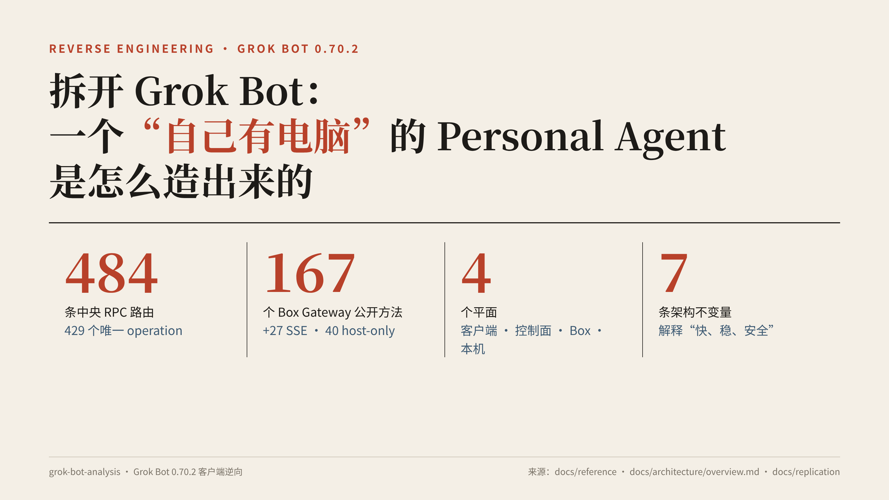
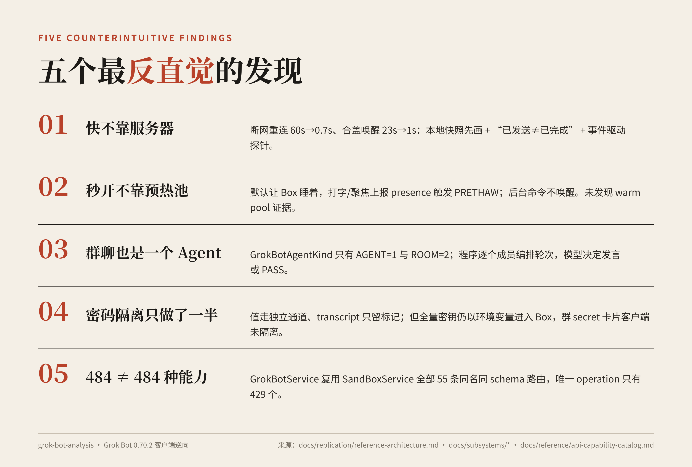
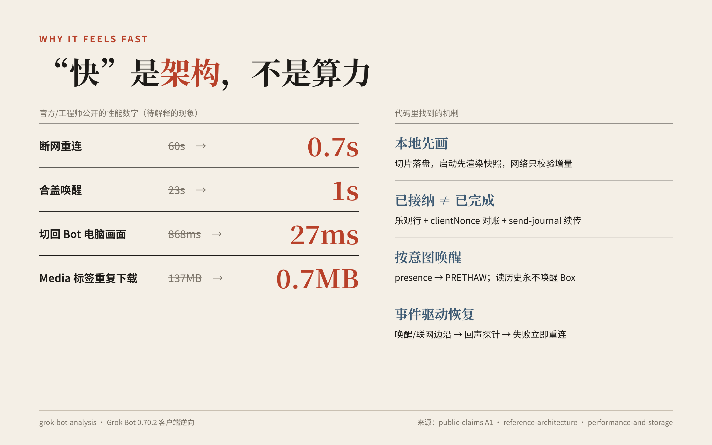
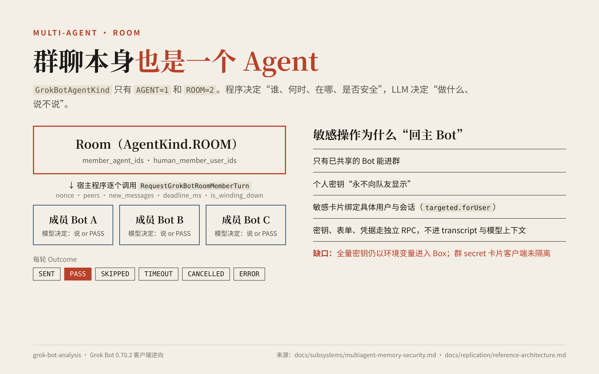
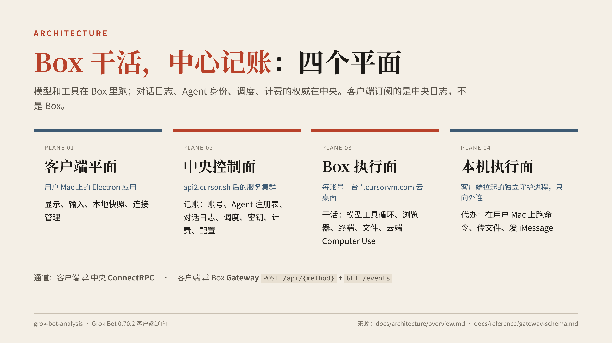
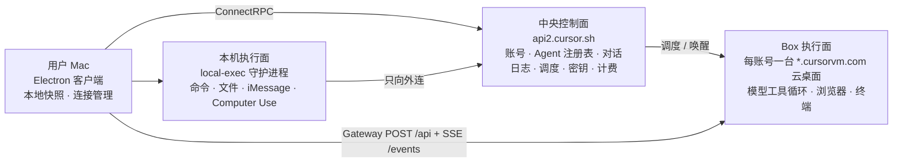
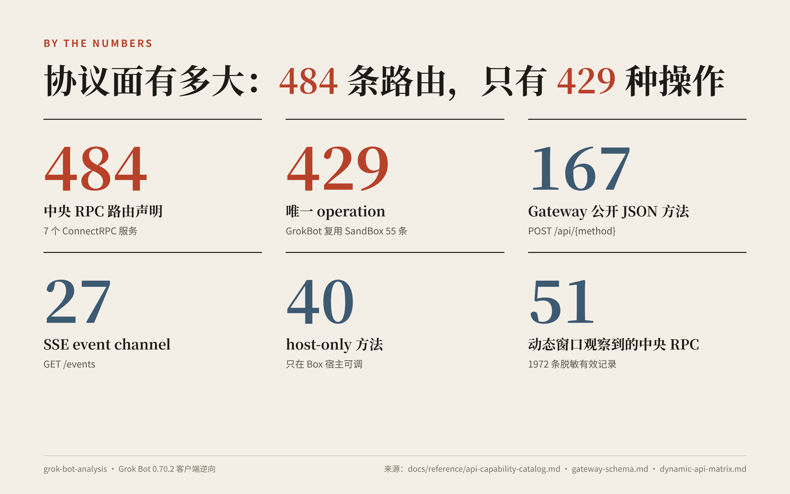

# 拆开 Grok Bot：一个"自己有电脑"的 Personal Agent 是怎么造出来的

> 基于 Grok Bot 0.70.2 桌面客户端逆向（静态分析 + 脱敏抓包 + REA 核验）。从界面一路追到协议，每条结论都标了证据等级，并附代码行号或抓包行号。

   

## 五个最反直觉的发现

1. **"断网重连 60s→0.7s、合盖唤醒 23s→1s"靠的不是更快的服务器**，而是界面先画本地快照、"已发送"和"已完成"分成两件事，再加上事件驱动的连接探针。[→ 七条架构不变量](docs/replication/reference-architecture.md)
2. **云电脑"秒开"不靠预热池，靠"默认睡着、按人的意图提前唤醒"。** 打字、聚焦会上报 presence，触发 `PRETHAW`；后台命令不唤醒 Box。抓包里没有找到 warm pool 的证据。[→ 为什么感觉快](docs/subsystems/performance-and-storage.md)
3. **群聊本身也是一个 Agent。** `GrokBotAgentKind` 只有 `AGENT` 和 `ROOM` 两种取值；每轮由程序逐个成员编排，"说不说话"由各成员的模型决定，可以返回 `PASS`。[→ 多 Agent 与记忆](docs/subsystems/multiagent-memory-security.md)
4. **密码"不进对话"只做到了一半。** 秘密值走独立通道，transcript 只留一个标记；但全量密钥仍会以环境变量的形式进入 Box，群里的 secret 卡片在客户端也没有做隔离。[→ 敏感操作隔离](docs/subsystems/multiagent-memory-security.md)
5. **484 条中央 RPC 路由，其实只有 429 个唯一 operation。** `GrokBotService` 原样复用了 `SandBoxService` 的全部 55 条路由；Box Gateway 另有 167 个公开方法、27 个 SSE channel、40 个 host-only 方法。[→ API 目录](docs/reference/api-capability-catalog.md) · [Gateway](docs/reference/gateway-schema.md)

 

## 谁适合读，能得到什么

- **做 personal agent / AI 助手产品的人**：一套已经被验证过的架构，包括四个平面、十个设计决策、七条不变量和落地顺序。
- **做 Agent 基础设施的人**：云桌面生命周期、Harness、记忆分层、凭据下发、本机执行的信任边界。
- **想弄懂 Grok Bot 为什么"快、稳、安全"的人**：每个公开说法都逐条落到了代码，见 [公开说法清单](docs/methodology/public-claims.md)。

## 架构一图

文字版架构图（mermaid）

**Box 干活，中心记账**：模型和工具在 Box 里跑，但对话日志、身份、调度和计费以中央为准。详见 [架构总览](docs/architecture/overview.md)。

## 三条阅读路线

| 时间 | 路线 |
|---|---|
| ⏱ 5 分钟 | 本页 → [架构总览](docs/architecture/overview.md)（四个平面、十个关键决策） |
| ⏱ 30 分钟 | [技术方案还原](docs/architecture/design-reconstruction.md) → 按兴趣选 [子系统](docs/subsystems/) |
| 🛠 想自己做 personal agent | [参考架构（七条不变量）](docs/replication/reference-architecture.md) → [复刻蓝图（P0–P2 路线图）](docs/replication/blueprint.md) → [接口参考](docs/reference/) |

## 数字一览

## 文档地图

| 目录 | 内容 |
|---|---|
| [docs/architecture/](docs/architecture/) | [总览](docs/architecture/overview.md) · [技术方案还原](docs/architecture/design-reconstruction.md) · [架构图 canvas](docs/architecture/diagram.canvas.tsx) |
| [docs/subsystems/](docs/subsystems/) | [Agent 运行时](docs/subsystems/agent.md) · [Box 云桌面](docs/subsystems/box.md) · [客户端控制面](docs/subsystems/client-control.md) · [本机执行与安全](docs/subsystems/local-exec-security.md) · [多 Agent / 记忆 / 敏感操作](docs/subsystems/multiagent-memory-security.md) · [性能与存储](docs/subsystems/performance-and-storage.md) |
| [docs/reference/](docs/reference/) | [中央 API 目录](docs/reference/api-capability-catalog.md) · [Gateway Schema](docs/reference/gateway-schema.md) · [客户端接口与信任边界](docs/reference/client-interface-map.md) · [动态 API 矩阵](docs/reference/dynamic-api-matrix.md) |
| [docs/replication/](docs/replication/) | [参考架构](docs/replication/reference-architecture.md) · [复刻蓝图](docs/replication/blueprint.md) |
| [docs/methodology/](docs/methodology/) | [证据等级与观测方法](docs/methodology/evidence-levels.md) · [公开说法清单](docs/methodology/public-claims.md) |
| [docs/appendix/](docs/appendix/) | [第一轮全栈报告](docs/appendix/round1-full-stack-report.md) · [动态观测计划（历史）](docs/appendix/dynamic-observation-plan.md) |
| [docs/assets/](docs/assets/) | README 配图（PNG）与生成脚本 [gen.py](docs/assets/src/gen.py) |
| [evidence/](evidence/) | [原始产物](evidence/artifacts/)（解包、格式化源码、脱敏抓包） · [REA 核验](evidence/rea/) · [抓包插件](evidence/tools/) |

两轮分析：第一轮由 Codex 完成（接口目录、全栈报告、复刻蓝图、动态抓包），第二轮由 Claude Opus 完成（公开说法核验、子系统调研、技术方案还原）。两轮结论冲突时，以 [技术方案还原](docs/architecture/design-reconstruction.md) 附录 C 为准。

## 覆盖范围

- 中央 ConnectRPC：484 条路由声明，429 个唯一 operation。
- Box-scoped Gateway：167 个公开 JSON 方法、27 个 SSE channel、40 个 host-only 方法。
- 动态窗口：51 个中央 RPC、11 个 Gateway endpoint。
- Electron Main/Preload/Coordinator/Local Exec、Harness、记忆分层、Linux GUI Box、VNC、macOS Computer Use 与 User Device Relay。
- 第二轮补充：BOX / TEMPORAL 两种运行方式及迁移、送达与去重、Box 预热休眠与凭据回收、出网隧道、秘密下发路径、群聊敏感卡片、REA 完整性核验，以及疑点 D1–D11 的结论。

## 证据说明

仓库保留完整分析目录，包括解包后的应用资源、格式化代码、REA 中间证据、脱敏网络 shape 和采集脚本。动态记录只保存协议结构、字段编号、状态和时序，不保存 token、cookie、账号值或消息正文。

结论分为“观察、推断、未知、推荐”。客户端证据无法直接证明服务端数据库、消息总线、虚拟化平台、模型路由或工作流引擎的具体产品选型。

## 使用边界

本仓库用于内部研究、竞品架构分析和兼容性验证。其中包含第三方应用的解包产物，不授予对原始软件的再分发权。
