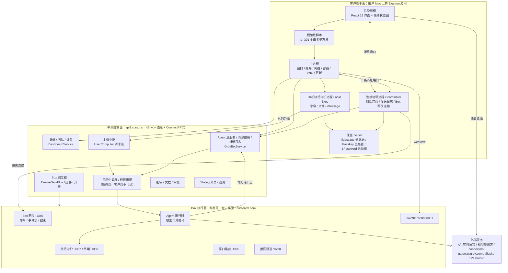

# Grok Bot 0.70.2 架构总览

> 摘自 [技术方案还原](design-reconstruction.md) 第 0–3 章（摘要、背景、设计原则、总体架构）。子系统细节见 [subsystems/](../subsystems/)，接口目录见 [reference/](../reference/)。


> **文档性质**：这是一份"倒推出来的原始技术方案"。写法模仿原团队的设计文档：先讲为什么做、做成什么样，再讲每个子系统怎么设计、关键流程怎么走，最后才是参数和证据。凡是客户端看不到的部分（服务端、Box 镜像内部），按客户端协议和行为反推，并明确标注。
>
> **与已有文档的关系**：`personal-agent-reference-architecture.md` 是"公开说法 → 代码证据"的逐条核验，偏证据；本文是"系统本来的样子"，偏设计。两者互补，本文附录 C 汇总了这一轮新增的核验结果。
>
> **证据约定**：正文默认讲设计本身，只在关键判断处标注：
> - **〔观察〕**：客户端代码、协议定义、签名信息或脱敏抓包直接可见；
> - **〔推断〕**：多处观察共同支持，但没有直接证据；
> - **〔未知〕**：在服务端或 Box 镜像里，客户端看不到。
>
> 没有标注的陈述，默认是〔观察〕。字段级细节和代码位置放在附录 B。
>
> **分析对象**：`/Applications/Grok Bot.app`，版本 0.70.2，Bundle ID `com.anysphere.sand`，开发者 Anysphere（Cursor 母公司），Team ID `DCNK4UB866`。`app.asar` 的 SHA-256 为 `8dd7b6c4…4ca4cf7`，与 Codex 分析时的包一致。分析方式为静态阅读解包源码、REA 6.4.0 结构分析、此前一次限时脱敏抓包；本轮没有启动应用，也没有向其服务发请求。

---

## 0. 摘要

**Grok Bot 是什么**：一个桌面端的"AI 同事"产品。每个用户拥有若干个长期存在的 Agent（Bot），它们像联系人一样可以私聊、拉群、互相发消息；每个账号配一台云端 Linux 桌面（内部叫 Box），Agent 在上面用浏览器、终端、文件完成工作；需要时也能在用户自己的 Mac 上执行命令、发 iMessage。产品由 Cursor 团队用 Cursor 现有的账号、计费、实验、云 Agent 基础设施搭起来，品牌是 xAI 的 Grok，语音直连 xAI 的实时接口。

**系统由四个平面组成**：

| 平面 | 一句话职责 | 运行在哪里 |
|---|---|---|
| 客户端平面 | 显示、输入、本地快照、连接管理 | 用户 Mac 上的 Electron 应用 |
| 中央控制面 | 记账：账号、Agent 注册表、对话日志、调度、密钥、计费、配置 | `api2.cursor.sh` 后面的 Cursor 服务集群 |
| Box 执行面 | 干活：模型的工具循环、浏览器、终端、文件、云端 Computer Use | 每账号一台 `*.cursorvm.com` 云桌面 |
| 本机执行面 | 代办：在用户 Mac 上跑命令、传文件、发 iMessage | 客户端拉起的独立守护进程，只向外连 |

**十个关键设计决策**（后文逐一展开）：

1. **Box 干活，中心记账**：模型和工具在 Box（或服务端 worker）里跑，但对话日志、Agent 身份、调度、计费的权威都在中央。客户端订阅的是中央日志，不是 Box。
2. **本地先画，网络后校验**：花名册、对话尾部、侧边栏等按"切片"落盘，启动时先渲染快照，再增量校验。
3. **"已接纳"和"已完成"是两件事**：发送只拿到"已接纳"，结果走订阅流；客户端用 nonce 做幂等，断网补发前先查送达状态。
4. **电脑默认睡，按人的意图醒**：状态查询永远不唤醒；打字、聚焦、打开电脑画面才逐级唤醒。读历史产物优先走中央存储，不叫醒 Box。
5. **事件驱动的连接恢复**：系统唤醒、联网边沿触发回声探针，探针失败立即重连，退避只是兜底。
6. **Agent 和群聊是同一种实体**：群聊是 `kind=ROOM` 的 Agent，复用对话、通知、权限；群里每一轮由确定性的编排器分发，模型只决定"说不说、说什么"。
7. **程序管"谁、何时、在哪、是否安全"，模型管"做什么、说什么"**：唤醒、审批、去重、截止、计费、开关都写死在程序里；内容判断交给模型。
8. **值不进对话**：密码、验证码、卡号通过独立通道直达浏览器或宿主进程，对话里只留"已提供"。但这条只保证到对话和界面这一层，密钥快照仍会整体下发到 Box（见 §4.8）。
9. **多进程故障域隔离**：界面、连接协调、本机执行、原生权限 helper 各自独立进程，任何一个崩溃都不拖垮其他。
10. **一切能力可灰度、可双轨迁移**：几乎所有能力都挂在远程开关上，客户端带默认值；Agent 运行方式正从 BOX 向服务端托管的 TEMPORAL 迁移，协议里有 OFF / SHADOW / LIVE 等档位。

---

## 1. 背景与目标

### 1.1 产品定义

Grok Bot 想做的是"一直在线、有自己电脑、可以托付账号的 AI 同事"。从客户端能力看，它覆盖这些场景〔观察〕：

- **对话与协作**：一对一聊天、多 Agent 群聊、有真人参与的团队群、Agent 之间互发消息、@ 指定负责人；
- **执行**：云端桌面上的浏览器、终端、文件；用户本机的命令、文件、iMessage；子 Agent 与异步任务；
- **长期运行**：定时与事件触发的自动化（routine）、任务清单、后台复苏；
- **知识与记忆**：每个 Bot 的私有记忆、与用户共有的事实、团队共享摘要、文件库、技能（skill）与工作流；
- **托付**：密钥卡片、安全表单、1Password、Passkey/YubiKey 代签、Chrome 登录态导入、人工接管；
- **渠道**：Slack、Teams、邮件收件箱、日历、GitHub 等 SCM、MCP 插件、模板市场；
- **其他入口**：实时语音通话、教 Bot 做任务（录制演示）、团队分享与模板。

### 1.2 目标

| 维度 | 目标 | 由哪些设计保证 |
|---|---|---|
| 体验：快 | 打开即可用；按下回车立刻看到消息；切换 Bot 电脑画面无等待 | 本地快照、乐观发送、VNC 热池（§4.1、§4.6） |
| 体验：不丢不重 | 断网、崩溃、合盖都不丢消息，不出现重复消息 | send-journal、nonce 幂等、送达查询、游标续传（§4.2.5、§5.2） |
| 体验：一直在线 | 用户关掉电脑，routine 照样跑 | 调度在控制面，Box 可被服务端按多种原因唤醒（§4.3.7） |
| 成本 | 云桌面不常驻计算 | 默认休眠、按意图唤醒、轮询不唤醒、读产物不唤醒（§4.6.2） |
| 安全 | Bot 不在对话里看到密码；高危操作要人确认 | 值通道、类型化卡片、宿主专用方法、本机逐次审批（§4.8） |
| 可演进 | 新能力可灰度上线，运行时可平滑迁移 | 远程开关 + 客户端默认值、双 harness、迁移档位（§13） |

### 1.3 非目标

这些是客户端代码明确"不做"的事，它们反过来塑造了架构：

- **客户端不跑模型，也不跑工具循环**。Electron 里没有模型调用和工具编排；`composer_send_prewarm` 这类预热开关存在但没有读取点。
- **不把工具调用展示给用户**。工具调用数据会下发到客户端，但渲染层直接丢弃，只显示"正在做什么"的摘要。
- **渲染进程不持有任何凭据和本机能力**。所有特权操作经预加载脚本白名单转到主进程。
- **桌面不开入站端口**。本机执行只向外连，云端通过中继把请求推下来。
- **默认不做本机的屏幕操控**。本机 Computer Use 的代码打进了包，但开关默认关，sidecar 下载地址默认为空（§4.7.4）。
- **不承诺"永远热机"**。所谓"一直在线"是"持久磁盘 + 随时可唤醒"，计算并不常驻。

### 1.4 约束与前提

- **复用 Cursor 基础设施**〔观察〕：中央 API 与 Cursor IDE 同域（`api2.cursor.sh`），账号、团队、计费、MCP 市场走 Cursor 的 `DashboardService`；遥测走 Cursor 的 `AnalyticsService` 和 `metrics.cursor.sh`；远程开关用 Statsig；云端编码 Agent 复用 `BackgroundComposerService`；文件仓复用 `AgentStoreService`。客户端里还留着大量 Cursor IDE 的共享代码和配置（例如上下文压缩、用户偏好提炼的配置），但 Grok Bot 没有调用它们（附录 C 的 D2）。
- **macOS 优先**：Computer Use helper、iMessage、通知权限原生模块都是 macOS 专属；Windows 的代码路径和开关存在但未完整开放。
- **Electron 42**：桌面壳基于 Electron 42.1.0、React 19。

---

## 2. 设计原则

**P1 控制面记账，执行面干活。** 一切需要"跨设备一致、跨 Box 迁移、跨重启存活"的状态，权威副本都在中央：Agent 身份、对话日志、记忆分片、自动化、密钥元数据、额度。Box 和本机只是执行器，可以休眠、重建、迁移，丢了也能从中央恢复。这条原则直接决定了"Box 睡着时照样能看历史、能收消息"。

**P2 本地先画，网络后校验。** 每个需要在首屏出现的数据都有本地快照（带版本号、作用域、大小上限、写入防抖），先渲染再增量对齐。网络只负责"校验和补差"，不负责"首次显示"。

**P3 接纳与完成分离。** 写操作只承诺"已接纳"，结果通过订阅流到达。幂等键由客户端生成；响应丢失时先查状态再决定是否重试。

**P4 执行环境按意图分级唤醒。** 命令分 person（人在等）和 background（后台）两级；查询状态显式 `wake=false`；读产物先走中央对象存储。唤醒只因为"人想用"或"服务端有任务"。

**P5 恢复靠事件，退避只兜底。** 系统层面的电源、网络事件是第一信号；对活连接做端到端回声探针；用代际计数器让旧的重连尝试自然作废。

**P6 程序决定边界，模型决定内容。** 凡是影响成本、安全、一致性、可重复性的决策写成程序：谁可以说话、何时截止、是否需要审批、是否唤醒、是否扣费。模型拿到的是"有限、可审计的动作集合"。

**P7 值不进对话。** 敏感值走旁路，对话里只留引用或"已提供"标记；宿主专用方法（host-only）构成一条渲染层够不着的信任边界。

**P8 故障域隔离。** 渲染、连接协调、本机执行、原生权限分属不同进程，进程之间用带上限的消息端口通信，支持原子替换。

**P9 可灰度、可回退。** 每个能力都有远程开关，客户端内置默认值和配置 schema；开关拉取失败时有确定的降级行为（例如新窗口最多等 5 秒，超时全部按关闭处理）。

**P10 渐进披露。** 界面只放"表达意图"的入口（文字、语音、附件、教任务）；"执行能力"由 Agent 在需要时用结构化卡片唤出。

---

## 3. 总体架构

### 3.1 全景图



### 3.2 各平面职责与边界

| 平面 | 拥有的权威状态 | 不拥有的东西 | 可以丢失吗 |
|---|---|---|---|
| 客户端 | 草稿、发送日志、界面布局、本地快照（都是副本或待发） | 对话、Agent、额度的权威 | 可以，重装后从中央恢复（未发出的草稿除外） |
| 中央控制面 | 账号、团队、Agent 注册表、对话日志、记忆分片、自动化、密钥元数据、额度、开关 | 正在运行的工具进程、桌面画面 | 不可以 |
| Box | 正在运行的 Agent 进程、工作目录 `/workspace`、浏览器会话、桌面 | 对话权威（只写入中央） | 可以重建或迁移；工作区靠快照和迁移保留 |
| 本机执行 | 本地审批记录、常驻授权 | 任何会话状态 | 可以，随时重启 |

### 3.3 部署拓扑与域名

| 域名 | 作用 | 协议 |
|---|---|---|
| `api2.cursor.sh` | 中央 API、登录轮询、更新源（`/updates/api/update/darwin-arm64/sand/<版本>/…/stable`）、Box 本机执行凭据 | ConnectRPC over HTTP/2（`application/proto`、`application/connect+proto`） |
| `api3.cursor.sh/tev1/v1` | Statsig 事件代理 | HTTPS |
| `metrics.cursor.sh` | Sentry 错误上报 | HTTPS |
| `*.<集群>.cursorvm.com` | 每个 Box 的网关、VNC、执行、出网隧道入口；抓包看到的集群是 `us10` | HTTPS / SSE / WebSocket |
| `wss://api.x.ai/` | 实时语音（客户端只允许这一个前缀） | WebSocket |
| `connectors-gateway.grok.com`、`grok.com`、`x.com` | 部分第三方连接器的 OAuth 回调与代理 | HTTPS |
| `downloads.cursor.com/computer-use-sidecar/…` | 本机 Computer Use sidecar 的下载清单（默认空） | HTTPS |

中央 API 的响应头里普遍带 `x-envoy-upstream-service-time`，所以边缘层是 Envoy 或兼容代理〔推断〕。Box 的子域名嵌了集群名，客户端 DNS 诊断白名单里只写了 `dev4`、`us8` 两个集群，比线上的 `us10` 旧，说明集群在持续扩展。

### 3.4 技术栈

| 层 | 选型 |
|---|---|
| 桌面壳 | Electron 42.1.0，主进程分"基础层 + 业务层"两段加载，V8 代码缓存 |
| 界面 | React 19、StyleX、Lingui 国际化、TipTap 3 富文本、自研虚拟列表 `@anysphere/virtual`、React Query（辅助查询） |
| 领域状态 | 自研常驻领域客户端（SandClient）+ Resource Store + `useSyncExternalStore` |
| 后台进程 | Electron `utilityProcess`（连接协调、本机执行） |
| 协议 | ConnectRPC + Protobuf（中央）；JSON 命令 + SSE（Box 网关，schema 校验）；WebSocket（VNC、语音、出网隧道） |
| 校验 | Zod、Protobuf 描述符、内嵌 Gateway JSON Schema |
| 原生 | Swift helper（iMessage、通讯录、本机 Computer Use），Rust 签名器（CTAP2），C++ Node 扩展（tree-sitter、进程列表、通知权限） |
| 可观测 | OpenTelemetry、Sentry、Statsig、结构化日志上报 |
| 更新 | Squirrel（macOS） |

### 3.5 两条主数据流

整个系统可以概括成一条"命令流"和一条"事件流"：

```text
命令流（写）：用户/卡片 → 渲染进程 → 主进程或协调进程 → 中央 API → 调度到 Box 或服务端 worker
事件流（读）：Box/worker 执行 → 写入中央对话日志 → 中央订阅流 → 协调进程 → 渲染进程
旁路（低延迟）：协调进程 ⇄ Box 网关（Box 相关资源、事件、宿主命令），只在需要时连接
```

抓包印证了这一点〔观察〕：一次使用中，消息发送走中央的 `SendGrokBotUserMessage`，对话订阅走中央的 `WatchGrokBotTranscripts`（21 次），本机中继走中央的 `WatchGrokBotUserComputerRequests`（24 次）；Box 网关只被访问了少量资源接口（工作流、异步任务、桌面状态、附件图片、窗口焦点）和健康检查。也就是说，**即便 Agent 运行在 Box 上，用户看到的对话也来自中央日志**。Box 网关是一条加速和补充通道，不是对话的权威来源。

---


## 继续阅读

- 子系统：[Agent](../subsystems/agent.md) · [Box](../subsystems/box.md) · [客户端控制面](../subsystems/client-control.md) · [本机执行与安全](../subsystems/local-exec-security.md) · [多 Agent/记忆/敏感操作](../subsystems/multiagent-memory-security.md) · [性能与存储](../subsystems/performance-and-storage.md)
- 完整设计文档第 4 章起：[design-reconstruction.md](design-reconstruction.md)
