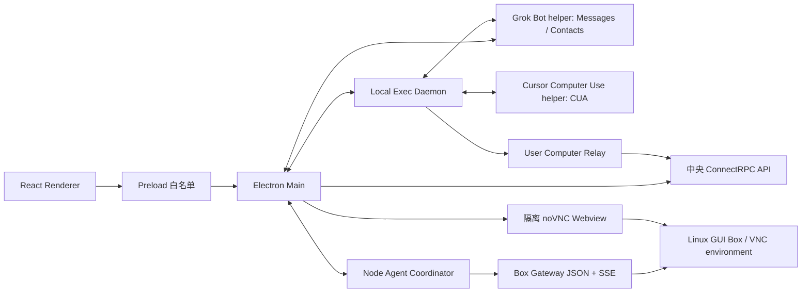
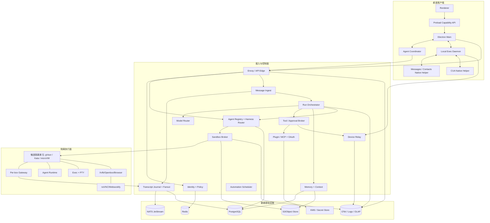
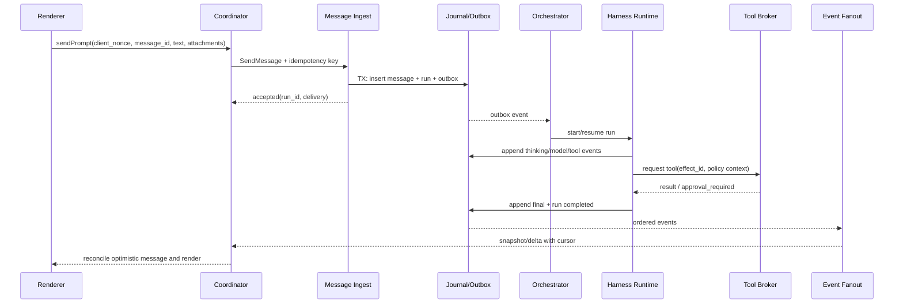

# testAgent / Grok Bot 可复刻实现蓝图（独立草案）

> 目标：从当前可观察的桌面客户端、协议契约与脱敏动态流量出发，给出一套能够落地的端到端复刻方案。
>
> 本文不是竞品服务端源码还原。所有内容严格分为：
>
> - **观察（O）**：客户端代码、打包契约或动态 shape 直接证明。
> - **推断（I）**：由多个观察共同支持，但仍无法证明具体产品或内部实现。
> - **推荐（R）**：我方实现选择，不代表竞品采用。
> - **未知（U）**：现有证据无法判断，需通过实验或业务决策补齐。

## 1. 结论先行

推荐走“**模块化控制面 + 可替换 Harness + 隔离执行面**”路线：

- 桌面端保留 Electron 多进程结构；Renderer 不直接接触本地执行、凭证和系统权限。
- 对外 API 采用 ConnectRPC/Protobuf，实时事件先用可恢复 SSE；本机设备通过出站长连接/服务端流接单。
- 核心真相源是 PostgreSQL 中的 Agent/Run 元数据和按 Agent 有序的 append-only event journal；Redis 只做租约、在线状态和短缓存。
- Agent Harness 以适配器隔离：P0 用数据库队列驱动的 `SandboxHarness`，P1 再引入 Temporal 作为长任务编排候选，而不是把 Temporal 写死进业务域。
- 云执行面先采用 Kubernetes + gVisor/受限容器；高风险租户再升级 Kata Containers 或 Firecracker。持久工作区放对象存储快照/PVC，不依赖容器本身存活。
- Box 内运行轻量 Gateway、Agent Runtime、Exec/PTy、浏览器桌面和 VNC；中央控制面只下发短期、限域 credential。
- 本机执行由独立 daemon、Messages/Contacts 原生 helper 和另一套 CUA 原生 helper 分域完成；所有请求经过 policy、approval、ownership 和审计，不让云端直接持有任意本机控制通道。
- P0 不做“云手机 Farm”。现有观察支持 Linux GUI Box + VNC，也存在有限的用户移动设备 Relay 契约；但没有 Android/iOS 云设备池证据，若要建设应作为独立 P2 产品线。

推荐方案的核心不是复刻 400 多个接口，而是先复刻五个不变量：

1. 消息接纳必须幂等，断网重试不能产生重复回合。
2. Transcript 必须可追加、可回放、可从游标恢复。
3. Harness、工具和执行位置必须可路由、可中断、可恢复。
4. 凭证、审批和本机权限必须位于独立信任边界。
5. Sandbox 必须是可替换的执行资源，而不是 Agent 的唯一状态载体。

## 2. 证据基线

动态材料是 value-free shape 快照，只保留 endpoint、字段/field number、协议、状态与顺序，不保留 token、cookie、消息正文或响应值；运行时使用过现有用户 profile，因此任何写调用都不能归因给某个具体人工动作。本草案没有继续触发任何动态请求。

| ID | 已观察事实 | 证据 | 不应越界推断 |
|---|---|---|---|
| O1 | 客户端 package manifest 标明版本 0.70.2，并列出 React、ConnectRPC、React Query、TipTap、OTel、Sentry、Statsig。 | [version](../../evidence/artifacts/app-asar/package.json#L5)、[ConnectRPC](../../evidence/artifacts/app-asar/package.json#L59)、[OTel](../../evidence/artifacts/app-asar/package.json#L67)、[Sentry](../../evidence/artifacts/app-asar/package.json#L74)、[Statsig](../../evidence/artifacts/app-asar/package.json#L76)、[React Query](../../evidence/artifacts/app-asar/package.json#L78)、[TipTap](../../evidence/artifacts/app-asar/package.json#L79)、[React](../../evidence/artifacts/app-asar/package.json#L97) | 无法据此判断服务端语言或框架。 |
| O2 | Electron Main 代码 fork 独立 Node Agent Coordinator，并连续创建三条 MessagePort 通道。 | [utility process](../../evidence/artifacts/formatted/electron-main/main-app.cjs#L100086)、[first channel](../../evidence/artifacts/formatted/electron-main/main-app.cjs#L100087)、[third channel](../../evidence/artifacts/formatted/electron-main/main-app.cjs#L100089) | 三条通道的全部业务语义仍需进一步还原。 |
| O3 | 打包代码包含 Linux/X11 `DISPLAY`、`xdotool`/`xprop` 路径，并定义 exec、PTY、window router、host gateway、主/分叉 noVNC 与 egress tunnel 端口，支持“Linux GUI Box”判断。 | [DISPLAY](../../evidence/artifacts/formatted/local-exec-daemon/main.cjs#L120127)、[xdotool](../../evidence/artifacts/formatted/local-exec-daemon/main.cjs#L120184)、[Box ports](../../evidence/artifacts/formatted/electron-main/main-app.cjs#L93096) | 无法证明底层是 Pod、普通容器、gVisor、Kata 或 Firecracker。 |
| O4 | `EnsureSandBoxResponse` 的静态 schema 含 cluster、tenant、pod_id、network token、exec URL/token、VNC URL、Gateway URL/token、run state 和 image。 | [node-agent-coordinator/main.cjs](../../evidence/artifacts/formatted/node-agent-coordinator/main.cjs#L9732) | `pod_id` 只是字段名，不能据此证明 Kubernetes。 |
| O5 | Coordinator 客户端实现 JSON `POST /api/{method}`、独立 `sendPrompt`、SSE 连接、回复 schema 校验和重连/看门狗。 | [schema validation](../../evidence/artifacts/formatted/node-agent-coordinator/main.cjs#L41026)、[Gateway POST](../../evidence/artifacts/formatted/node-agent-coordinator/main.cjs#L41376)、[sendPrompt](../../evidence/artifacts/formatted/node-agent-coordinator/main.cjs#L41720)、[SSE backoff](../../evidence/artifacts/formatted/node-agent-coordinator/main.cjs#L41051) | Gateway 的服务端语言、进程位置和部署形式未知。 |
| O6 | 动态窗口确实出现一次 `SendGrokBotUserMessage`，响应成功；还出现 `GetGrokBotSendStatus`。 | [request shape](../../evidence/artifacts/runtime-api-shapes.jsonl#L1459)、[response shape](../../evidence/artifacts/runtime-api-shapes.jsonl#L1460)、[send status](../../evidence/artifacts/runtime-api-shapes.jsonl#L1686) | 抓包已脱敏，不能判断正文、操作者、最终任务效果或触发因果。 |
| O7 | Local Exec daemon bundle 定义 `/local-exec/requests` 与 `/local-exec/responses`，以及 exec、上传、下载、取消、Messages 和 AI tool discovery 等帧。 | [local-exec-daemon/main.cjs](../../evidence/artifacts/formatted/local-exec-daemon/main.cjs#L81896)、[exec frame](../../evidence/artifacts/formatted/local-exec-daemon/main.cjs#L81929) | 不能据此断言服务端队列产品或所有帧均在本次动态窗口执行过。 |
| O8 | 用户电脑 Relay bundle 定义短期 credential/server-authoritative 字段，并设置并发 8、backlog 64、响应最多 256 帧/约 8 MiB、文件帧约 4 MiB。 | [frame/batch constants](../../evidence/artifacts/formatted/local-exec-daemon/main.cjs#L155181)、[concurrency/backlog](../../evidence/artifacts/formatted/local-exec-daemon/main.cjs#L155192)、[credential schema](../../evidence/artifacts/formatted/local-exec-daemon/main.cjs#L145406) | 这些是打包实现参数，不是我方必须照抄的容量结论。 |
| O9a | `Grok Bot Computer Use` helper（`CUGrokBotService`）的可见调用面是 Messages/Contacts：snapshot、附件复制、发送消息、权限检查、联系人和 handle 解析；Main 和 Local Exec 都有调用路径，通信使用 service.json 中的 Unix socket 与 newline JSON。 | [helper identity](../../evidence/artifacts/formatted/electron-main/main-app.cjs#L79551)、[Messages methods](../../evidence/artifacts/formatted/electron-main/main-app.cjs#L79739)、[Local Exec default](../../evidence/artifacts/formatted/local-exec-daemon/main.cjs#L128112) | 不能把该可见调用面直接等同于键鼠/截图 CUA。helper 二进制可能还有未被这些 JS callsite 使用的能力。 |
| O9b | Local Exec 的默认 CUA 目标是外置 `Cursor Computer Use.app` / `CUCursorService`，但可由 `CUA_SERVICE_APP` 覆盖；JS RPC 契约包含 screenshot/click/scroll/drag/type/key/control，并检查辅助功能和屏幕录制权限。 | [default bundle/executable](../../evidence/artifacts/formatted/local-exec-daemon/main.cjs#L120624)、[override](../../evidence/artifacts/formatted/local-exec-daemon/main.cjs#L120611)、[permission schema](../../evidence/artifacts/formatted/local-exec-daemon/main.cjs#L120283)、[screenshot](../../evidence/artifacts/formatted/local-exec-daemon/main.cjs#L120414) | 该 artifact 不在 testAgent bundle 内，本机默认路径也未找到；其实现语言、完整 native 能力和实际运行目标仍未知。 |
| O10 | VNC webview 使用持久隔离 partition，并关闭 Node integration、开启 context isolation 与 sandbox；URL token 被转成请求头。 | [partition](../../evidence/artifacts/formatted/electron-main/main-app.cjs#L125719)、[token header](../../evidence/artifacts/formatted/electron-main/main-app.cjs#L125746)、[webPreferences](../../evidence/artifacts/formatted/electron-main/main-app.cjs#L125865) | 具体 VNC server 产品未知。 |
| O11 | 打包错误目录定义了 `transcript-mirror.ts` 相关的 WAL/checkpoint/canonical-journal 失败码与预期恢复语义。 | [journal append error](../../evidence/artifacts/formatted/electron-main/main-core.cjs#L30450)、[corrupt-tail error](../../evidence/artifacts/formatted/electron-main/main-core.cjs#L30468)、[checkpoint-publication error](../../evidence/artifacts/formatted/electron-main/main-core.cjs#L30495) | 当前 bundle 中未找到对应实现或调用点；不能据此断言它运行在桌面客户端、Box 或服务端，也不能证明该路径当前启用。 |
| O12 | 打包的客户端 feature-config fallback 声明 speculative summarization 的 70% token 阈值；用户意图模板最多读取 100 个近期会话，并要求每项至少 4 个会话证据。 | [summarization config](../../evidence/artifacts/formatted/electron-main/main-app.cjs#L59880)、[user intent config](../../evidence/artifacts/formatted/electron-main/main-app.cjs#L60502) | 运行时 flag 可覆盖或关闭；不能推断所有长期记忆都由客户端生成，或一定使用向量数据库。 |
| O13 | 服务端契约暴露私有记忆、提升到团队记忆、团队上下文摘要。 | [memory API](../reference/api-capability-catalog.md#L502)、[promote API](../reference/api-capability-catalog.md#L504) | 记忆抽取模型、检索算法与向量库均未知。 |
| O14 | Runtime capability schema 声明 durable identity、Temporal creation、agent messaging、server rooms 字段，并定义 Harness migration rollout/status schema。 | [runtime capabilities](../../evidence/artifacts/formatted/node-agent-coordinator/main.cjs#L27026)、[migration rollout](../../evidence/artifacts/formatted/node-agent-coordinator/main.cjs#L27136) | 不能由字段名证明这些 capability 已开启，更不能证明使用 Temporal.io SDK。 |
| O15 | 中央契约共 7 个服务、484 条路由、429 个唯一方法，覆盖 AgentStore、AI、Analytics、BackgroundComposer、Dashboard、GrokBot、Sandbox。 | [API catalog](../reference/api-capability-catalog.md#L3) | 接口数量不等于微服务数量，也不代表 P0 应全部复刻。 |
| O16 | `SandMachine.kind` 的客户端模型允许 `desktop` / `ios` / `android`；另有 `mobile_local_tools`、`PhoneEcho`、`MobileReadCalendar` 协议面，而桌面 daemon 文案明确 phone 不支持 shell/read/await-shell/file transfer。 | [machine kinds](../../evidence/artifacts/formatted/electron-main/main-app.cjs#L42638)、[machine list schema](../../evidence/artifacts/formatted/electron-main/main-app.cjs#L48640)、[mobile capabilities](../../evidence/artifacts/formatted/local-exec-daemon/main.cjs#L145273)、[phone restriction](../../evidence/artifacts/formatted/local-exec-daemon/main.cjs#L81906) | 只能证明客户端支持有限的移动设备 Relay 契约；不能证明 Android/iOS 云真机、Appium/WDA 或完整手机自动化。 |

## 3. 三条复刻路线与取舍

| 路线 | 适合目标 | 核心技术 | 优点 | 主要代价 | 粗估 |
|---|---|---|---|---|---|
| A. 快速验证型 | 先验证“Agent 能持续工作并交付” | Electron + TypeScript 模块化单体；Postgres；Redis；S3；SSE；托管容器 Sandbox；无 Temporal | 最快、团队小、运维面少 | 隔离和长任务恢复能力有限；后续拆分成本较高 | 6–8 人，10–14 周完成 P0 |
| **B. 可演进生产型（推荐）** | 做正式产品，兼顾速度、可靠性和安全 | Electron/TS；Go ConnectRPC 控制面；Node/TS Agent Runtime；Postgres；Redis；NATS JetStream；S3；Kubernetes + gVisor；可选 Temporal | 边界清晰；能从 P0 平滑升级；流式和设备 Relay 容易扩容 | 两种服务端语言、K8s 和执行面提高工程门槛 | 8–10 人，12–16 周 P0；再 12–16 周到 P1 |
| C. 高隔离企业型 | 强合规、多租户、高风险浏览器/代码执行 | 微服务；Kafka；Temporal；Kata/Firecracker；多区域；HSM/KMS；细粒度策略与审计 | 最强隔离、容灾和组织治理能力 | 初期最慢、成本最高，容易过度设计 | 14–20 人，9–15 个月到成熟生产 |

### 推荐路线 B 的判断

推荐 B，不建议一开始复制竞品全部表面：

- 对产品价值最关键的是 Agent 的可靠任务闭环，而不是 marketplace、voice、金融连接、Teams/Slack 等长尾接口。
- 对安全最关键的是执行面、审批、credential broker 与租户隔离；这些不能用普通“聊天后端”补丁式实现。
- 对演进最关键的是 Harness adapter、event journal 和 object store 三个稳定抽象。只要它们稳定，队列、工作流引擎和 Sandbox 底座都能替换。
- Temporal、Kafka、Firecracker 都应在压力或合规需求出现后引入。它们是候选解，不是架构身份。

## 4. 事实架构与推荐架构分栏

### 4.1 已观察的事实架构



这张图只表达客户端可见边界。中央 API 后面有多少服务、队列、数据库以及 Box 的虚拟化产品均未知。

### 4.2 我方推荐端到端架构



### 4.3 组件边界

| 层/组件 | 竞品已观察事实 | 我方推荐职责 | 明确不负责 |
|---|---|---|---|
| Desktop Renderer | React UI，依赖 preload 能力。 | 展示、输入、乐观 UI、增量渲染；只持有无特权 view model。 | 文件系统、shell、OS 凭证、任意 IPC。 |
| Preload | 暴露白名单 API，VNC 有独立 preload。 | 版本化 capability contract、参数校验、sender 校验。 | 业务状态和长期任务。 |
| Electron Main | 管理窗口、进程、网络、VNC、本机权限。 | 进程 supervisor、凭证安全存储、更新、窗口与深链。 | Agent 推理循环。 |
| Agent Coordinator | 独立 Node utility process，连接 Gateway、处理数据流。 | 本地 session cache、事件合并、重连、发送 journal、客户端 transcript mirror。 | 云端最终真相和任意本机执行。 |
| API Edge | 动态响应存在 Envoy 风格 header，具体部署未知。 | TLS、认证、tenant context、限流、trace、协议转发。 | 业务状态机。 |
| Identity/Policy | 有团队、隐私、准入、usage、机器、管理员策略接口。 | OIDC、RBAC/ABAC、entitlement、策略合并、审计主体。 | 工具执行。 |
| Agent Registry | 有 Agent、team agent、group、room、template、harness 字段。 | Agent identity、配置版本、成员关系、Harness binding。 | Transcript 大对象和模型流。 |
| Message Ingest | 有 message_id/client nonce、send status 和发送去重行为。 | 幂等接纳、鉴权、策略校验、建立 run、写入 outbox。 | 实际执行 Agent 回合。 |
| Transcript Journal | 契约有实时 Watch、page/tail/window；错误目录提到 WAL/checkpoint，但实现位置与启用状态未知。 | 每 Agent 有序事件流、游标恢复、snapshot、unread/read model。 | 大附件正文。 |
| Run Orchestrator | 契约有 Box/Temporal-labelled Harness、interrupt、subagent、async task。 | Run 状态机、重试、取消、超时、子任务、恢复。 | 模型供应商细节。 |
| Model Router | 有 AvailableModels 和多种 model config。 | provider adapter、配额、fallback、流式规范化、成本与安全过滤。 | 业务记忆真相。 |
| Tool/Approval Broker | 有 local tool、auto-review、form/widget、cookie/WebAuthn、secret 审批。 | 工具 schema、policy decision、human approval、调用凭证、审计。 | 保存明文秘密到 transcript。 |
| Sandbox Broker | 有 Ensure/Recreate/Hibernate/Snapshot/Migration/Upgrade 等契约。 | 分配、唤醒、租约、镜像、快照、配额、健康检查。 | Agent 长期身份。 |
| Box-scoped Gateway | 静态实现含 `/api/*`、`sendPrompt`、`/events`、`/health`；动态观察到 `/events`、`/health` 和 7 个其他 `/api/*` 方法，未观察到 `/api/sendPrompt`。 | 推荐作为 Box 相关聚合 API、局部状态、Agent runtime/desktop 路由与 SSE；竞品的物理部署位置未知。 | 账户级全局真相。 |
| User Device Relay | 短期 credential、Watch/Poll/Submit、ownership。 | 只允许设备出站连接；任务排队、ACK、限流、重放保护。 | 直接公网暴露用户机器端口。 |
| Messages/Contacts Helper | `Grok Bot Computer Use` helper 的可见 JS 调用面包括 Messages 数据、发送、附件、权限与 Contacts；Main 与 Local Exec 均会复用它。 | 与 Renderer/Agent 运行时分离，专管 Full Disk Access、Automation、Contacts 等系统授权。 | 键鼠/截图 CUA、云端认证和 Agent 编排。 |
| Computer Use Helper | Local Exec 默认定位 `Cursor Computer Use` / `CUCursorService`，可被环境变量覆盖，通过 Unix socket RPC 与辅助功能/录屏权限 schema 交互。 | 专管截图、键鼠动作、control session 与动作级超时。 | Messages 数据访问、云端认证和策略决策。 |
| MCP/Plugin/OAuth | 大量 registry、tool schema、OAuth 和配置接口。 | 目录、安装、变量、OAuth broker、tool capability snapshot。 | Agent run 编排。 |
| Memory/Context | 有 transcript summary、私有 facts、团队提升、用户偏好提炼。 | 分层记忆、证据、生命周期、检索与 context assembly。 | 替代原始 transcript。 |
| Object Store | 有预签名读写、multipart、etag、tombstone、snapshot。 | 附件、artifact、workspace snapshot、template blob。 | 高频小状态和锁。 |
| Automation | 有 automation、meeting、email、task/todo、webhook。 | 触发器、调度、幂等 job、外部事件归一化。 | Agent 核心状态。 |
| Observability | OTel、Sentry、Analytics、数值指标均可见。 | trace/log/metric/audit 分离，贯穿 desktop→run→tool→sandbox。 | 收集秘密、消息正文或屏幕内容作为默认日志。 |

## 5. Harness 与 Agent Runtime 设计

### 5.1 事实与未知

- **观察**：schema 存在 `BOX` 与 `TEMPORAL` 类 Harness 语义，以及 durable identity、Temporal creation、agent messaging、server rooms 和迁移字段/API。
- **未知**：Temporal 是否指 Temporal.io，工作流由谁执行，模型循环位于中央还是 Box，状态落在哪里。
- **推断**：这些 migration/rollout schema 与“从 Box 强绑定生命周期演进到更持久、服务端可路由模型”相容，但不能证明 rollout 已启动或覆盖范围。

### 5.2 推荐抽象

```text
HarnessAdapter
  createRun(runSpec) -> runHandle
  resumeRun(runId, cursor) -> eventStream
  sendInput(runId, input)
  interrupt(runId, reason)
  getStatus(runId)
  recover(runId)
```

实现三个适配器：

1. `SandboxHarness`：Agent loop 在 Linux Box 内执行，适合代码、浏览器、长驻工作区。
2. `ServiceHarness`：Agent loop 在中央 worker 执行，工具通过 Broker 远程调用，适合低风险/无 GUI 任务。
3. `DurableWorkflowHarness`：P1 候选，可由 Temporal 或数据库状态机实现，负责跨小时/天的等待、重试和人工审批。

Harness Router 的输入应只有：租户策略、Agent binding、任务 capability、数据位置、风险等级、成本预算与区域。不要让 UI 直接选择某个基础设施产品。

### 5.3 Run 状态机

```text
QUEUED → STARTING → RUNNING ↔ WAITING_TOOL
                         ↔ WAITING_APPROVAL
                         ↔ WAITING_USER
                         ↔ SUSPENDED
RUNNING → SUCCEEDED | FAILED | CANCELED | TIMED_OUT
```

状态转换必须满足：

- 每次转换带 `expected_version`，用乐观锁阻止双 worker 同时推进。
- 每个外部副作用都有 `effect_id` 和幂等记录。
- Worker 使用有 TTL 的 lease；lease 丢失后停止写入。
- cancellation 是持久事件，不是仅发送一次内存信号。
- run 可以更换 worker/Harness，但 `agent_id`、`conversation_id` 和 transcript seq 不变。

### 5.4 编排产品取舍

| 方案 | 何时采用 | 优点 | 风险 |
|---|---|---|---|
| Postgres job + outbox（P0 推荐） | 日均任务量不高、等待时间以分钟为主 | 简单、可审计、减少基础设施 | 复杂补偿和超长 workflow 需要自行实现 |
| Temporal（P1 候选） | 大量长等待、人工审批、定时恢复、跨服务补偿 | Durable execution 成熟，代码表达力强 | 运维/认知成本；workflow versioning 需纪律 |
| Kafka + 自研状态机 | 已有成熟 Kafka 平台、吞吐极高 | 事件生态和回放强 | 状态机、定时器和 exactly-once 语义自研成本大 |

## 6. 一条消息的完整数据流



推荐细节：

1. 客户端先在本地 send journal 写 `PREPARED`，再发送 `client_nonce + message_id`。
2. 服务端在一个事务内写入 user message、run 和 outbox；唯一键建议为 `(tenant_id, agent_id, message_id)` 与 `(tenant_id, client_nonce)`。
3. API 返回的是“已接纳”，不是“已完成”。若响应丢失，客户端查 `GetSendStatus`，不要无条件重发。
4. Orchestrator 消费 outbox 后创建 run lease，选 Harness，组装 context，再调用模型。
5. 每个模型 delta、tool request、approval 和最终消息都追加到 journal；fanout 只是投影，不是事实源。
6. SSE 使用 `cursor/last-event-id` 恢复；发现 seq gap 时拉 page/window snapshot，再继续增量。
7. 客户端只有看到 authoritative echo 才把本地 queued send 标为完成。

## 7. 云 Box、VNC 与本机 Computer Use

### 7.1 云 Box 推荐实现

Box 镜像建议包含：

- `agent-runtime`：模型回合、tool adapter、context client。
- `box-gateway`：`/health`、`/api/*`、`/events`、局部授权。
- `exec-daemon`：命令、文件、PTY、取消和输出分帧。
- `Xvfb/Wayland headless + Openbox`：GUI session。
- `Chromium`：浏览器自动化与用户可见桌面。
- `TigerVNC/Xvnc + websockify + noVNC`：仅为推荐候选；竞品具体 VNC server 未知。
- `egress-agent`：强制 HTTP CONNECT/透明代理和 DNS policy。
- `snapshot-agent`：工作区 manifest、增量上传、恢复。

生命周期：

```text
ABSENT → PROVISIONING → READY → BUSY → IDLE → HIBERNATING → HIBERNATED
                    ↘ DEGRADED/FAILED      ↘ SNAPSHOTTING
HIBERNATED → RESTORING → READY
```

推荐的数据分离：

- Root filesystem：不可变镜像，可随版本替换。
- Workspace：独立卷或 overlay，周期性生成 manifest + 对象存储快照。
- Agent/Transcript：中央 journal；不随 Box 删除。
- Secrets：运行时短租约挂载或代理填充，不写入快照。
- Browser profile：按敏感级别选择临时 profile 或加密持久 profile。

### 7.2 隔离路线

| 隔离方案 | P0/P1 建议 | 适用 | 取舍 |
|---|---|---|---|
| 普通容器 + seccomp/AppArmor | 仅内部原型 | 可信代码 | 成本最低，但不适合任意用户代码/浏览器 |
| Kubernetes + gVisor | **P0/P1 默认** | 多租户通用 Agent | 成本和隔离平衡，生态成熟 |
| Kata Containers | 企业租户可选 | 需要 VM 边界且希望 K8s 体验 | 启动和资源成本更高 |
| Firecracker microVM | P2 高风险池 | 强隔离、细粒度计费 | 镜像、网络、快照和调度平台建设量最大 |

### 7.3 VNC 安全

- VNC URL 中的一次性 token 在 Main 中转为 Header，Renderer 不应长期看到 bearer secret。
- 使用独立 Electron partition、独立 preload、`nodeIntegration=false`、`contextIsolation=true`、`sandbox=true`。
- 只允许可信 VNC frame 调用 clipboard bridge；限制文本大小并记录敏感动作审计。
- noVNC edge 校验 user、sandbox、session、audience、expiry；token 建议 60–120 秒并可单次兑换。
- 主桌面与 fork 窗口使用不同 audience，禁止 token 横向复用。

### 7.4 本机 Local Exec、Messages Helper 与 CUA Helper

推荐链路：

```text
Tool Broker
  → Device Relay Queue
  → Desktop daemon 出站 Watch/Long Poll
  → Policy + Approval
  → shell/file executor
  → Messages/Contacts native helper（独立权限域）
  → CUA native helper（独立权限域）
  → framed response + ACK
  → Tool Broker
  → Agent Runtime
```

关键约束：

- 设备只建立出站连接，不开放入站监听端口。
- credential 绑定 `user_id + machine_id + account_generation + audience`，5–15 分钟过期；切换账号时旧连接立即失效。
- request 包含 `request_id/effect_id/deadline/capability/risk_digest`，daemon 对重复请求返回缓存结果。
- 采用竞品可见的有界并发思想：例如默认并发 8、backlog 64，但应通过压测调参。
- 大文件走预签名对象存储，不在 JSON/Proto 帧中无限 base64；帧和批次设硬上限。
- Messages/Contacts helper 与 CUA helper 使用不同的 identity、可见方法集和 OS 权限，不把 Full Disk Access/Contacts 权限与辅助功能/屏幕录制权限合并成一个 capability。
- CUA helper 只接收结构化动作；daemon 不直接执行未受约束的 AppleScript。Messages 发送等副作用也必须独立审批。
- “获得辅助功能权限”不等于“每次动作获批”。系统权限、产品策略与用户审批是三层独立门槛。

### 7.5 移动端与云真机边界

- **观察**：`SandMachine.kind` 模型允许 `desktop` / `ios` / `android`，同时契约包含 `mobile_local_tools`、`PhoneEcho`、`MobileReadCalendar`；phone 明确不承载 shell/read/await-shell/file-transfer。这只说明客户端存在有限的用户移动设备 Relay 表面。
- **观察限制**：未见 Appium、WebDriverAgent、Android emulator、iOS simulator、设备租约或移动设备池调度协议；因此不能称为云真机 Farm，也不能断言已支持通用手机 UI 自动化。
- **推荐**：P0/P1 仅把已选定的移动端能力建成 capability-scoped Relay。若业务需要云真机，P2 新建 `MobileDeviceHarness`，独立维护设备租约、Appium/WDA、录像、安装包、账号清理和硬件健康度。

## 8. 记忆分层

### 8.1 建议的六层模型

| 层 | 内容 | 真相源 | 写入策略 | 检索策略 |
|---|---|---|---|---|
| L0 Working Context | 当前回合、工具结果、短期 scratchpad | Run worker 内存 + checkpoint | 每步 checkpoint；短 TTL | 直接注入，严格 token budget |
| L1 Transcript Journal | 用户/助手/工具/审批的有序事件 | PostgreSQL journal | append-only；不可静默改写 | seq/window/thread 精确读取 |
| L2 Conversation Summary | 一个会话阶段的压缩摘要 | Summary version 表 + blob | 达 token 阈值异步生成；保留 source range | 按 conversation/session 读取 |
| L3 Private Facts | Agent/用户私有偏好、事实、工作方式 | `memory_fact` | 必须带证据、confidence、expiry、scope | 结构过滤 + FTS/向量 rerank |
| L4 Team Knowledge | 经批准提升的共享事实、团队 summary | `team_memory` | 去重、审批、版本化 | tenant/team 过滤后检索 |
| L5 Documents/Artifacts | 文件、网页、模板、技能、产物 | S3 + 元数据 DB | 预签名上传、etag、tombstone | 元数据/全文；必要时向量索引 |

### 8.2 推荐写入规则

- 不把模型推测自动写成长期事实；候选记忆先进入 `PROPOSED`。
- 每条事实至少保存 `source_event_ids[]`、抽取器版本、confidence、scope、PII class、expiry。
- 明确用户纠正可以提高权重；弱推断需要多次独立证据。竞品客户端“至少 4 个会话支持”可作为偏好型记忆的初始门槛，而非所有事实统一规则。
- 私有→团队必须是显式 promotion；团队→组织需要管理员策略。
- 删除会话时执行反向 lineage 查询，删除或降级依赖该证据的记忆。

### 8.3 向量数据库取舍

- **未知**：竞品是否使用向量库、何种产品、在哪一层使用。
- **P0 推荐**：Postgres FTS + metadata filter；规模小、可解释、便于删除。
- **P1 候选**：pgvector，适合与租户/权限 SQL 联合过滤。
- **P2 候选**：OpenSearch/Vespa/Milvus 等独立检索层，仅在文档量或 QPS 证明需要时引入。
- 向量命中必须再做 ACL 和 evidence 校验，不能把向量索引当授权边界。

## 9. 服务端逐能力实现候选

| 能力域 | 已观察能力 | 推荐实现 | P 阶段 |
|---|---|---|---|
| Identity/Team/Policy | 用户、团队、隐私、准入、管理员策略、usage | OIDC/WorkOS 类 IdP；Postgres RBAC/ABAC；Redis entitlement cache；OPA/Cedar 可选 | P0 基础，P1 团队策略 |
| Agent Registry | Agent、team agent、group、room、template、ACL | Postgres aggregate + version；Harness binding；soft delete | P0 |
| Message Ingest | Send、status、interrupt、rollback、fresh conversation | ConnectRPC；事务 + outbox；幂等键；状态查询 | P0 |
| Transcript/Event | Watch、tail/page/window、thread/unread | 分区 journal；NATS fanout；SSE resume；snapshot projection | P0 |
| Agent Orchestration | run、async task、subagent、room member turn | P0 Postgres queue；P1 Temporal 候选；lease + cancellation | P0/P1 |
| Model Routing | 模型目录、参数、fallback、语音/图像入口 | provider adapter；统一 streaming events；预算/限流/审计 | P0 文本，P2 多模态 |
| Context Builder | summaries、skills、memory、attachments、team context | token allocator；source-ranked assembly；cache by version | P0 基础，P1 完整 |
| Memory | 私有 facts、团队 promotion、summary/profile/log | Postgres facts + evidence；异步 extraction；可选 pgvector | P1 |
| Sandbox Broker | ensure/state/recreate/hibernate/migrate/upgrade/snapshot | K8s controller/operator；lease；warm pool；snapshot manifest | P0 ensure，P1 lifecycle |
| Box Gateway | JSON command、SSE、health、VNC/host bridge | Box 内 Go/Node 单进程；schema registry；短期 token | P0 |
| Exec/PTy | shell、文件、后台任务、上传下载、cancel | Rust/Go daemon；structured frames；output truncation；resource limits | P0 |
| VNC/Browser Desktop | noVNC、fork、clipboard、computer-action | Xvfb/Openbox/Chromium + VNC；独立 edge auth | P0 浏览，P1 稳定性 |
| User Device Relay | machine registry、credential、Watch/Poll/Submit | 出站 stream + queue；machine ownership generation；ACK/dedupe | P0 shell/file，P1 CUA/Messages |
| Messages/Contacts Native Bridge | Grok Bot helper 的 Messages/Contacts 调用面与权限检查 | 签名原生 helper + Unix socket RPC；与 CUA 分离授权和审计 | P1 |
| Native CUA | Cursor Computer Use helper 的 screenshot/input/control/permission | 签名原生 helper + Unix socket RPC；session mutex；与 Messages 分离 | P1 |
| MCP/Plugin Registry | marketplace、server、tools、resources、variables | registry DB；manifest/schema version；server-side capability snapshot | P1 |
| OAuth Broker | MCP OAuth、connections、account scopes | PKCE/state；encrypted token store；refresh worker；scope policy | P1 |
| Secret Broker | secret/vault/1Password/WebAuthn/cookie approval | KMS envelope encryption；opaque credential refs；fill-by-proxy；never return plaintext to model | P1/P2 |
| Attachments/AgentStore | chunk、image rendition、presign、multipart、locks、tombstone | S3 + Postgres metadata；presign；lease lock；async preview/index | P0 附件，P1 Store |
| Automation | schedules、tasks/todos、meeting/email/webhook | scheduler + durable job；event normalization；idempotent trigger | P1/P2 |
| Voice | Realtime credential、VAD、ASR/TTS/tool bridge | WebRTC/WebSocket realtime gateway；ephemeral provider token | P2 |
| Billing/Metering | access、hard limit、period usage、plan | immutable usage ledger；aggregation；entitlement decision | P1 |
| Telemetry/Flags | logs/events/traces/numeric metrics/flags | OTel Collector；Sentry；ClickHouse/Loki；Statsig/Unleash 类 flags | P0 |

## 10. 接口草案

### 10.1 外部控制面

```text
AgentService
  CreateAgent
  GetAgent / ListAgents
  SendMessage
  GetSendStatus
  InterruptRun
  WatchAgentEvents          // server stream

SandboxService
  EnsureSandbox
  GetSandboxState
  HibernateSandbox
  RecreateSandbox
  CreateSnapshot
  WatchSandboxOperation     // server stream

DeviceRelayService
  RegisterMachine
  IssueMachineCredential
  WatchRequests             // server stream
  PollRequests
  SubmitResponses

PluginService
  ListPlugins / InstallPlugin
  ListTools
  BeginOAuth / CompleteOAuth

MemoryService
  ListPrivateFacts
  PromoteFactsToTeam
  GetContextSummary
```

### 10.2 `SendMessage` 最小契约

```text
request:
  tenant_id, agent_id, conversation_id
  message_id, client_nonce, sent_at_ms
  text/rich_text, reply_to_id
  attachment_refs[]
  machine_id?, requested_harness?
  traceparent

response:
  accepted
  run_id
  delivery_mode
  authoritative_event_id?
  refusal_code?
```

语义：同一 `client_nonce` 重放必须返回同一逻辑结果；服务端只有在事务提交 message/run/outbox 后才能返回 `accepted=true`。

### 10.3 事件 envelope

```text
event_id, event_type, schema_version
tenant_id, agent_id, conversation_id, run_id
seq, occurred_at_ms
causation_id, correlation_id, traceparent
visibility, sensitivity
payload | payload_object_ref
```

首批事件类型：

- `message.user.accepted.v1`
- `run.started.v1`
- `model.delta.v1`
- `tool.requested.v1`
- `approval.requested.v1`
- `approval.resolved.v1`
- `tool.completed.v1`
- `message.assistant.completed.v1`
- `run.completed.v1`
- `sandbox.state.changed.v1`
- `memory.candidate.created.v1`

## 11. 数据模型

建议所有业务表包含 `tenant_id`，ID 使用 UUIDv7/ULID，敏感实体带 `data_region` 和 `classification`。

| 表/聚合 | 关键字段 | 说明 |
|---|---|---|
| `agents` | id, owner, team_id, config_version, harness_binding, status | Agent 持久身份 |
| `conversations` | id, agent_id, current_session_id, head_seq | 会话头与读模型 |
| `runs` | id, conversation_id, state, version, harness, lease_owner, lease_until, budget | 可恢复运行状态机 |
| `events` | agent_id, seq, event_id, type, run_id, payload/ref, created_at | append-only；`(agent_id, seq)` 唯一 |
| `idempotency_keys` | tenant_id, scope, key, request_hash, result_ref, expires_at | API 重放保护 |
| `outbox` | id, aggregate_id, event_type, payload, published_at | 事务出站 |
| `tool_calls` | effect_id, run_id, tool, args_hash, state, result_ref | 副作用幂等 |
| `approvals` | id, effect_id, policy_digest, state, actor, expires_at | 结构化审批与审计 |
| `machines` | id, user_id, account_generation, capabilities, last_seen, revoked_at | 用户设备注册 |
| `device_requests` | id, machine_id, effect_id, state, deadline, acked_at | Local Exec queue |
| `sandboxes` | id, owner, cluster, runtime_class, state, image, lease, snapshot_id | 执行资源 |
| `sandbox_snapshots` | id, manifest_ref, image_version, file_count, bytes, state | 工作区持久化 |
| `objects` | id, tenant_id, bucket_key, etag, size, classification, tombstoned_at | 附件与 artifact 元数据 |
| `memory_facts` | id, subject, scope, fact, confidence, evidence_ids, status, expires_at | 可审计长期记忆 |
| `summaries` | id, scope, source_seq_start/end, model, prompt_version, blob_ref | 可重算摘要 |
| `plugins` / `installations` | manifest_version, tool_schema, policy, config_ref | MCP/插件目录与安装 |
| `oauth_connections` | provider, account_scope, encrypted_token_ref, generation, expires_at | OAuth 生命周期 |
| `automations` / `jobs` | schedule, timezone, next_fire_at, dedupe_key, state | 定时/事件触发 |

不建议把 transcript 存成一个不断覆盖的大 JSON。它会放大冲突、难以流式恢复，也无法可靠追踪审批与副作用。

## 12. 队列、存储与技术选型

| 类别 | 推荐默认 | 替代方案 | 选择依据 |
|---|---|---|---|
| API | ConnectRPC + Protobuf | gRPC、REST/JSON | 与观察一致；浏览器/Node/Go 代码生成和 streaming 兼顾 |
| 主数据库 | PostgreSQL | CockroachDB/Spanner | 事务、约束、JSONB、FTS、生态；先做单区域 HA |
| 短状态 | Redis | KeyDB/Valkey | lease、presence、rate limit、热点缓存；不可做唯一真相源 |
| 事件总线 | NATS JetStream | Kafka/PubSub/SQS | P0/P1 运维较轻、request/reply 与持久流兼顾 |
| 工作流 | Postgres queue → Temporal 候选 | Cadence、自研 | 先简单，待长任务和补偿复杂度证明后升级 |
| 对象存储 | S3 兼容 + KMS | GCS/Azure Blob | presign、multipart、versioning、生命周期成熟 |
| 搜索/向量 | Postgres FTS + pgvector | OpenSearch/Vespa/Milvus | 先保证 ACL/删除/可解释性，规模驱动拆分 |
| Sandbox | Kubernetes + gVisor | Kata/Firecracker/托管 sandbox | 默认平衡速度与隔离，高风险池再升级 |
| 网络边缘 | Envoy/Connect proxy | Nginx/HAProxy | HTTP/2、ConnectRPC、header policy、mTLS、观测 |
| Egress | Envoy CONNECT proxy + Cilium policy | 自建透明代理 | 域名/目标审计、动态策略和强制出口 |
| Model gateway | 自研薄 adapter + provider SDK | LiteLLM 类代理 | 保持统一事件和计费；避免把业务状态塞入模型代理 |
| 可观测性 | OTel Collector + Prometheus + Loki/ClickHouse + Sentry | Datadog 等 SaaS | trace 跨客户端/服务/Box，业务日志与审计分离 |

服务端语言是我方选择：

- Go：API Edge、Device Relay、Sandbox Broker、Journal/Fanout 等高并发/流式组件。
- TypeScript/Node：桌面端、Box Agent Runtime、MCP adapter、产品快速迭代层。
- Rust：只有当 exec daemon、PTY 或高风险解析器确实需要更强内存安全时再引入。
- Python：用于离线评测、记忆抽取实验或 ML job，不进入核心控制面热路径。

## 13. 安全与凭证域

### 13.1 信任边界

```text
Renderer（低信任）
  < Preload 白名单
Electron Main / Coordinator（用户桌面高权限）
  < 短期租户 token
Central Control Plane（业务真相）
  < sandbox-scoped token
Sandbox / Browser / User Code（敌对执行面）

Local Exec Daemon（用户设备执行）
  < Unix socket + 独立授权域
Messages/Contacts Helper（Full Disk Access / Automation / Contacts）
  !=
CUA Helper（辅助功能 / 屏幕录制 / 键鼠控制）
```

### 13.2 必做控制

- 所有 token 都有 audience、tenant、subject、capabilities、expiry、generation；禁止一个 token 同时访问中央 API、Box Gateway、VNC 和 Device Relay。
- Secret 以 opaque reference 进入模型和 transcript；实际填充由 Secret Broker 或 host-only bridge 完成。
- Approval 绑定规范化后的 action hash、目标、scope、run/effect；参数变化后旧批准无效。
- Sandbox 默认 deny egress，通过代理按域名、端口、协议和 Agent policy 放行；DNS 也走受控路径。
- 工具执行前后均写 audit：谁、哪个 Agent、哪个 run、什么能力、策略版本、审批人、结果分类。
- 截图、消息、联系人、语音和附件默认不进入遥测；trace 只保留 ID、耗时、状态和大小。
- Desktop daemon、两类原生 helper、Box image、插件 manifest 均签名；支持远程 revoke、强制升级和 kill switch。
- 多租户查询使用强制 `tenant_id` 过滤/RLS；对象存储 key 不可作为授权凭证。
- 重要状态修改采用 CSRF/state、PKCE、nonce、replay cache；Webhook 必须验签并做事件去重。

### 13.3 需要专门威胁建模的能力

1. Browser credential fill 与 WebAuthn/passkey ceremony。
2. 本机 shell、Messages、Contacts、屏幕与键鼠控制。
3. Agent 可发起的支付卡/金融连接。
4. 第三方 MCP server 的 prompt injection、schema 欺骗和 OAuth scope 扩张。
5. Sandbox 到中央控制面的 SSRF、metadata service 和 token exfiltration。

## 14. 可靠性、SLO 与测试

### 14.1 建议 SLO

| 指标 | P0 目标 | P1 目标 |
|---|---:|---:|
| 消息接纳 API p95 | < 800 ms | < 400 ms |
| authoritative echo p95 | < 2 s | < 1 s |
| SSE 断线恢复 | < 10 s | < 5 s |
| 已接纳消息重复可见率 | 0 | 0 |
| Run 状态丢失率 | 0 | 0 |
| Sandbox warm start p95 | < 20 s | < 8 s |
| hibernated restore p95 | < 90 s | < 45 s |
| Device Relay request ACK p95（在线） | < 3 s | < 1.5 s |
| Secret 明文进入日志/Renderer | 0 | 0 |

模型首 token 和任务完成时间应单独统计，避免把模型供应商延迟混入控制面 SLO。

### 14.2 测试金字塔

- Contract：Proto/JSON Schema 前后兼容、未知字段、旧客户端 fixtures。
- State machine：run/sandbox/approval 状态的 property-based test。
- Fault injection：POST 已提交但响应丢失、SSE gap、worker lease 丢失、Box 重启、对象上传半完成。
- Security：sandbox escape、egress bypass、token audience 混用、跨租户 IDOR、恶意 MCP schema、secret redaction。
- Desktop E2E：Renderer→preload→Main→daemon，权限未授权/撤销/切账号/升级。
- Load：高 fanout transcript、Relay 离线积压、Sandbox 冷启动风暴。
- Golden task：固定代码/浏览器任务集，衡量成功率、步骤数、成本、恢复率和人工接管率。

## 15. P0–P2 路线图

### P0：核心闭环（12–16 周）

范围：

- Electron 基础壳、账号、Agent 列表、Composer、流式 transcript。
- `SendMessage/GetSendStatus/WatchEvents/InterruptRun`。
- 单 Agent、单 SandboxHarness；文本模型路由。
- Linux Box：shell、read/write/grep、PTY、附件、Chromium + noVNC。
- Message journal、幂等、outbox、SSE 游标恢复。
- 简单 local exec：shell/file；逐次审批。
- 基础 RBAC、短期 token、egress allowlist、OTel/Sentry。
- workspace snapshot/restore 的最小版本。

不做：团队记忆、复杂 MCP OAuth、voice、1Password、Slack/Teams、云手机、多区域、公共 marketplace。

P0 验收门槛：

- 网络在发送后任意时刻断开，不产生重复 user message 或重复工具副作用。
- 客户端/Box/worker 任一进程重启，已接纳 run 可恢复或明确失败，不永久卡住。
- 删除 Sandbox 后可从 snapshot 恢复工作区，Transcript 不受影响。
- 本机工具未经 policy/approval 不执行，秘密不出现在 Renderer、模型上下文或普通日志。

### P1：可规模化产品（再 12–16 周）

- DurableWorkflowHarness（评估 Temporal 后决定）。
- Subagent、room/team agent、async task。
- 分层 summary、私有 facts、团队 promotion、pgvector 可选。
- MCP/Plugin registry、OAuth broker、tool capability snapshot。
- 完整 Local Exec + 分离的 Messages/Contacts helper 与 macOS CUA helper；机器 ownership/generation。
- Sandbox hibernate/wake、镜像升级、迁移、warm pool、磁盘压力治理。
- 团队策略、usage/metering、自动化调度、模板与 AgentStore。
- 压测、灾备、审计导出和高风险租户 gVisor/Kata 分池。

### P2：企业与长尾（16–24+ 周）

- Secret/Vault/1Password、WebAuthn、cookie broker。
- Slack/Teams、邮件、会议、Webhook 生态。
- Voice realtime、多模态与图像生成。
- Firecracker 高隔离池、多区域控制面、数据驻留。
- 公共 marketplace、插件审核、供应链签名。
- 独立 Android/iOS Device Farm（若业务成立）。
- 高级计费、组织策略、合规证据和管理员运维面。

## 16. 团队与工期粗估

### P0 推荐团队：8–10 FTE

| 角色 | 人数 | 主责 |
|---|---:|---|
| Tech Lead/Architect | 1 | 边界、协议、可靠性、安全评审 |
| Desktop/Electron | 2 | UI、preload/Main、Coordinator、更新与 E2E |
| Backend/Control Plane | 2–3 | API、journal、registry、orchestrator、policy |
| Sandbox/Infra | 1–2 | K8s、镜像、VNC、exec、snapshot、egress |
| Agent Runtime/LLM | 1 | model router、context、tools、评测 |
| QA/SDET | 1 | fault injection、desktop/Box E2E、回归 |
| Security/Design/Product | 共享 0.5–1 各 | 威胁建模、交互、范围和验收 |

粗估：P0 为 24–36 工程人月；使用成熟托管 Sandbox/IdP/对象存储可接近下限，自建多租户执行平台则接近或超过上限。

P1 建议保持 10–14 FTE，新增 1 名安全工程师、1 名数据/检索工程师、1–2 名 integrations 工程师。P2 若包含多区域、Firecracker、Voice 与移动设备池，通常需要 16–24 FTE，且应拆成独立小队。

以下工作不包含在工期内：自研基础模型、SOC 2/ISO 认证周期、24×7 SRE 轮值建设、第三方商务审核和大规模数据标注。

## 17. 最大风险与验证实验

| 风险 | 最小验证实验 | 通过标准 |
|---|---|---|
| 发送重试产生重复 run | 在 DB commit 后、HTTP response 前强制断网 1,000 次 | 1 个 message、1 个 logical run；状态可查询 |
| SSE 丢帧/乱序破坏 UI | 注入断线、重复、跨 10k seq gap | 客户端能 snapshot + cursor 恢复，最终一致 |
| 工具副作用重复 | worker 在工具完成后、结果提交前崩溃 | effect_id 去重；不会重复发送消息/支付/写文件 |
| Sandbox 隔离不足 | 红队测试 syscall、metadata、host mount、邻租户网络 | 无越权；egress 与租户边界均受控 |
| 本机账号切换被旧 daemon 接管 | credential 有效期内切账号并保留旧连接 | generation 更新后旧连接立刻失效 |
| 记忆污染 | 用冲突、撤回、过期事实构造评测集 | 错误长期事实率低于约定阈值，能追溯与删除 |
| CUA 误操作 | 对坐标漂移、窗口切换、权限撤销做 500 次回归 | 失败关闭；不在未知窗口继续动作 |
| Box 成本失控 | 1k 并发模拟 idle/wake/hibernate | 达到 warm start SLO，单位活跃小时成本可接受 |
| Workflow 版本升级卡住旧 run | 在长等待期间升级 worker/workflow | 旧 run 可继续、迁移或明确补偿 |

## 18. 关键决策门

进入 P0 前只需拍板五件事：

1. P0 是只做云 Box，还是同时做本机 shell/file；推荐两者都做，但 CUA 延后 P1。
2. 是否允许执行任意用户代码；如果允许，P0 就不能使用普通共享容器作为生产隔离。
3. Agent 的主要任务是代码、浏览器操作还是通用办公；这决定 Box 镜像、工具优先级与评测集。
4. 数据驻留和秘密处理要求；它决定单区域/多区域、KMS、日志策略和企业交付时间。
5. P0 是否允许托管 Sandbox；若必须自建，工期至少增加 4–8 周并需要额外基础设施人力。

## 19. 明确未知项

- 竞品服务端语言、仓库形态和真实微服务边界。
- PostgreSQL、Redis、Kafka/NATS、对象存储和向量数据库的实际产品。
- 是否真正采用 Temporal.io，或只是内部名为 Temporal 的 Harness。
- Box 是 Kubernetes Pod、gVisor、Kata、Firecracker 还是其他平台。
- `Grok Bot Computer Use` 与 `Cursor Computer Use` 两类 helper 的内部语言、共享代码关系及二进制完整能力。
- VNC server、窗口管理器和浏览器自动化引擎的准确选型。
- 模型供应商路由、fallback、缓存、成本与内容安全策略。
- 记忆抽取和检索是否使用 embedding，以及其精度/删除机制。
- 中央 API 与 Box Gateway 之间的内部身份、服务发现和消息总线。
- 动态窗口中一次消息写调用的内容、操作者和最终执行结果。

这些未知项不阻碍复刻，因为推荐架构把它们放在可替换适配器后面；但在对外声称“与竞品一致”之前，必须通过额外证据验证。

## 20. 实施顺序摘要

```text
Contract + Journal
  → Message Ingest + SSE recovery
  → SandboxHarness + shell/file
  → Browser desktop + noVNC
  → Approval + Local Exec
  → Snapshot/hibernate + policy/egress
  → Subagent + Memory + MCP/OAuth
  → Enterprise integrations / Voice / high-isolation pools
```

最先锁定协议、journal 与安全边界，最后扩展长尾能力。这条顺序既能复刻竞品的核心体验，也避免在尚未证明产品价值前承担全套企业基础设施成本。
