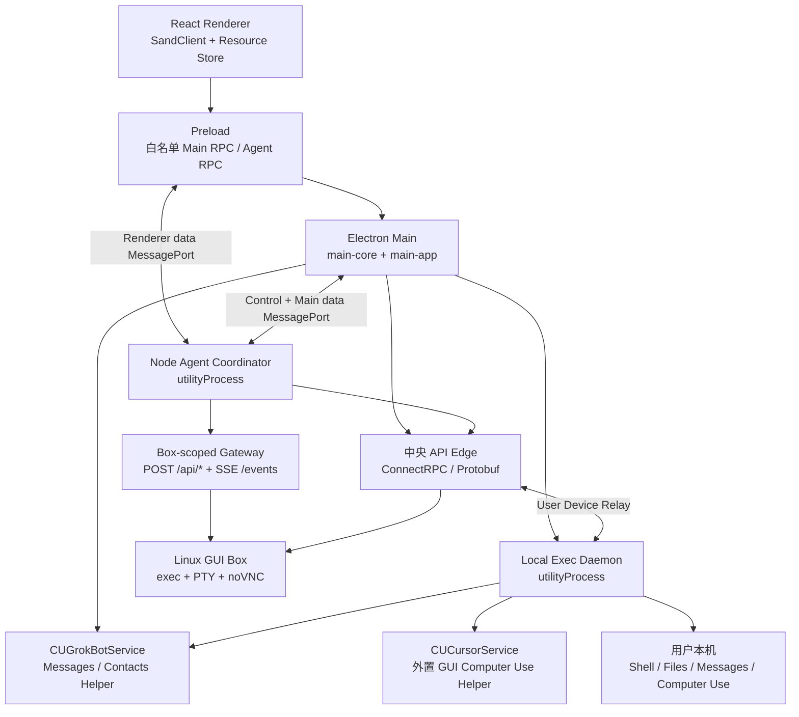
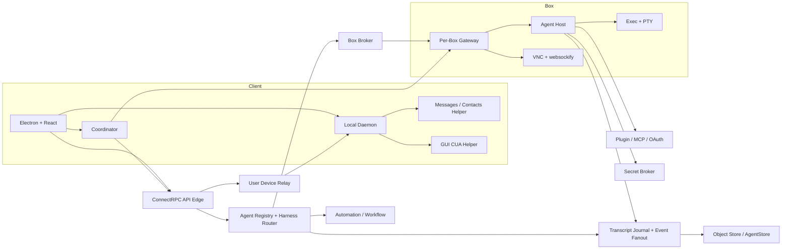

# testAgent / Grok Bot 0.70.2：客户端到服务端完整架构拆解与复刻蓝图

> 分析日期：2026-10-13  
> 目标应用：`/Applications/testAgent.app`（产品名 `Grok Bot`，包内名 `sand`，版本 `0.70.2`）  
> 原始用户路径 `/Users/bytedance/Documents/testAgent.app` 在后续阶段已不存在；静态解包和 REA Evidence 中仍保留该历史路径。  
> 方法：打包产物静态分析、REA 6.4.0 Evidence、运行进程观察、应用代理层脱敏网络 shape 采集、客户端代码与 Proto/Gateway Schema 交叉验证。

## 1. 一句话结论

testAgent 不是一个普通的 Electron 聊天客户端，而是一套“桌面控制台 + 多 Agent 控制平面 + Linux GUI 云电脑 + 用户本机执行代理 + SaaS/MCP/凭证连接器”的 AI teammate 系统。

它最重要的架构选择有五个：

1. 客户端把 UI、系统权限、Agent 流式状态、本机工具执行拆成多个进程，而不是全部塞进 Renderer。
2. 后端同时存在中央 ConnectRPC 控制面和 Box-scoped Gateway 数据面；Gateway 的物理部署位置未被客户端证明。
3. 客户端契约定义 `box` 与 `temporal` Harness 标签、创建路由和迁移能力，Coordinator 为它们提供统一 facade；本次证据不能说明所有路径都已在线启用。
4. 客户端发送和状态同步明确使用游标/sequence、幂等 nonce、authoritative echo 和重连补种；服务端 append-only journal 是高置信推断与推荐复刻设计，不是已知存储实现。
5. “云电脑”的直接证据是 Linux GUI Box + noVNC，具体承载和隔离实现未知。客户端机器模型同时允许 `desktop`、`ios`、`android`，但手机端本地工具能力受限，这不等于已动态验证移动设备，更不等于存在 Android/iOS 云真机池。

完整逐接口附录已经覆盖：

- [客户端接口与信任边界：301 个 Main 声明方法 + 12 个 desktopMount 方法](client-interface-map.md)
- [484 条中央 RPC 能力目录](api-capability-catalog.md)
- [484 条 API 能力矩阵](api-capability-matrix.md)
- [167 个 Gateway 方法、27 个 SSE channel、40 个 host-only 方法](gateway-schema-summary.md)
- [动态请求/响应矩阵](dynamic-api-matrix.md)

## 2. 证据等级与边界

本文采用四个标签：

- **观察**：打包代码、二进制、Proto、运行进程或脱敏网络记录直接支持。
- **推断**：由多个观察组合得到的高概率解释，但客户端不能证明服务端内部实现。
- **未知**：当前证据无法确定，不能当作竞品事实。
- **推荐**：本文给出的复刻设计选择，不代表竞品真实采用。

### 2.1 静态覆盖

REA 对历史 ASAR 的 SHA-256 为 `8dd7b6c4a58439d626a9a7b3766982b7c725db2bc1f6ff68a29fc1ec62ca4cf7`。分析了 616 个相关文件、600 个 JavaScript 文件、约 41.16 MB 文本、约 707 万 AST 节点，得到 5220 条 finding。

- Summary Evidence：`ev_37ab48fa94e1a4a125600eb8e827ddbf3c13773acedb6dfd9cea62e1d80f0e99`
- Parent application Evidence：`ev_b16bd6c5d19ac247f6013a27ed6b819ed335bd9faecc8ddacbee814a54ea8c98`
- 原始摘要：[javascript-summary.json](javascript-summary.json)

**限制**：应用 inventory 完成，但语义关系图是部分覆盖；若某关系未被 REA 图捕获，不能据此宣称它不存在。若结论来自静态代码，只能说明“实现被打包”，不能自动证明该路径在本次运行中被执行。部分 native 文件的 ASAR integrity metadata 与抽取字节不一致，因此本文不基于这些冲突文件做 native 行为断言。

### 2.2 动态覆盖

动态采集只落盘 host/path、header 名、字段类型、Protobuf field number/wire type、状态码与时间顺序，不保存 token、cookie、消息正文、账号值或响应值。冻结窗口包含 1972 条有效记录，动态命中 51 个唯一中央 ConnectRPC 路由和 11 个 Box Gateway endpoint。

**覆盖限制**：这些数字是本次时间窗口的下界，不是“所有线上接口都已执行”。代理覆盖了已观察到的 Chromium/Electron/Node 请求，但无法证明不存在绕过代理的 native socket、未启用 feature、其他账号权限或未触发业务路径。

脱敏原始记录：[runtime-api-shapes.jsonl](runtime-api-shapes.jsonl)

动态测试有一个重要边界：实际启动时使用了真实的 `/Users/bytedance/Library/Application Support/Grok Bot`，不是隔离 profile。因此：

- 窗口内观察到一次 `SendGrokBotUserMessage` 写调用，以及机器注册、1Password 同步等写调用。
- 因为正文和值都被即时丢弃，无法知道是谁触发、发送了什么、是否由某次 UI 操作导致。
- 后续没有继续触发可能计费、创建资源或改变状态的动作。

## 3. 产品定位与功能边界

**观察**：客户端能力覆盖聊天、长期 Agent、Group/Room、Subagent、Automation、Task/Todo、Skill/Workflow、MCP、插件市场、附件/文档、云电脑、本机 Shell/文件、macOS Computer Use、Messages/Contacts、Voice、Slack/Teams、GitHub、会议、邮件、Secrets/Vault/1Password、支付审批、模板和 Cloud Agent 发布。

**推断**：产品定位是“能长期存在、跨应用执行、可被调度、可在云端或用户设备上行动的 AI 同事”，而不是一次性代码补全或单会话聊天机器人。

**未知**：商业版实际开放的全部能力、不同套餐和组织策略下的能力组合，以及服务器是否对所有打包能力都已正式启用。

## 4. 客户端技术选型

| 层 | 观察到的技术 | 作用 |
|---|---|---|
| Desktop shell | Electron `42.1.0`，Node utility process | 窗口、更新、登录、系统权限、进程监督、网络与本机服务 |
| UI | React `19.3`、React DOM、StyleX、Lingui | 桌面 UI、国际化、样式 |
| 编辑器 | TipTap 3 / ProseMirror | Prompt 富文本、mention、链接等 |
| 客户端状态 | 长生命周期 `SandClient` domain graph、自研 Resource Store、`useSyncExternalStore` | Agent、Transcript、Box、账号等强一致资源状态 |
| 查询缓存 | React Query 5 | 辅助性异步查询；不是核心 Agent 状态模型 |
| RPC | ConnectRPC + Protobuf、JSON Gateway | 中央控制面和 Box 数据面 |
| 实时传输 | Connect server stream、SSE、WebSocket | Transcript、Gateway event、Voice、VNC、Local Exec |
| Schema | Zod + Proto descriptor + Gateway JSON Schema | IPC、请求、响应和运行帧校验 |
| 可观测性 | OpenTelemetry、Sentry、Statsig | trace、错误、指标、feature flag |
| 本机原生能力 | 打包的 Swift `CUGrokBotService`；Local Exec 另声明外置 `CUCursorService` | 前者由 Main 与 Local Exec 复用于 Messages/Contacts；后者通过 Unix socket 承载 GUI Computer Use，两套 helper 必须分别取证 |

包元数据见 [package.json](app-asar/package.json#L1)。核心状态并非“React Query 到处请求”，而是常驻的 domain client 将网络流、持久化和 UI 订阅统一起来。

## 5. 客户端进程与信任边界



### 5.1 Renderer

**观察**：Renderer 负责展示和领域资源订阅，不直接获得 Node 能力。主窗口设置 `contextIsolation=true`、`nodeIntegration=false`、`sandbox=true`，见 [main-core.cjs](formatted/electron-main/main-core.cjs#L32078)。

**设计意义**：即使某段对话 Markdown、网页预览或插件内容存在问题，也不能直接调用文件系统或任意 IPC。

### 5.2 Preload

**观察**：Preload 的 `desktop.main` schema 声明 301 个唯一方法。组装时隐藏 `stageAttachmentPath`、新增通用 `subscribe`，因此运行时 `desktop.main` 仍是 301 个 callable property；另有 `desktop.local` 5 个本地辅助方法、`desktopMount` 12 个方法、`coordinatorPort` 和 `sandRenderTrace` 两条 MessagePort 面。它没有把裸 `ipcRenderer` 暴露给页面。入口见 [preload.cjs](formatted/electron-preload/preload.cjs#L4272)，完整分类见 [客户端接口地图](client-interface-map.md)。

**推断**：这里同时承担类型收窄、sender/trust policy 和版本兼容边界，是客户端安全模型的重要一层。

### 5.3 Electron Main

**观察**：Main 分 `main-core` 与 `main-app` 两阶段：前者尽早建立窗口、安全策略、日志、更新、认证等基础设施；后者装配 Agent、Box、MCP、Voice、Local Exec 等业务能力。

**观察**：新窗口默认拒绝，跨 origin 导航转系统浏览器，见 [main-core.cjs](formatted/electron-main/main-core.cjs#L32141)。

### 5.4 Node Agent Coordinator

**观察**：Main 通过 Electron `utilityProcess.fork` 启动 `sand-node-agent-coordinator`，创建三条 MessagePort：control、renderer-data、main-data，见 [main-app.cjs](formatted/electron-main/main-app.cjs#L100084)。运行时 PID 81591 加载 tree-sitter，与 Coordinator 职责高度一致。

Coordinator 负责：

- Gateway 连接、SSE 重连、健康与 stall 检测。
- Agent roster、Transcript、Automation、Subagent 等运行态资源。
- `box` / `temporal` Harness 路由。
- Gateway transcript 与 server transcript tail 切换。
- 幂等发送、重试、epoch/sequence、重连 seed。
- 账号切换或进程异常后的销毁与重建。

Renderer 侧 pending call 有上限 256；端口可以原子替换，避免旧连接的 reply 污染新账号或新 generation。

### 5.5 Local Exec Daemon

**观察**：另一个独立 Node utility process 负责本机 Shell、文件、Messages、Computer Use、MCP、AI tool discovery 与文件传输；运行时 PID 81515 很可能对应它，但仅凭进程参数不能做到绝对命名。

**设计意义**：Renderer/Main 不直接执行 Agent 下发的命令。Daemon 使用短期 credential、machine ID、account generation 和 ownership；失去 ownership 时自动退出，降低跨账号或陈旧进程接管风险。

### 5.6 客户端能力如何分层

| 用户能力 | Renderer / domain state | 主要进程边界 | 恢复与一致性策略 |
|---|---|---|---|
| Chat / Transcript | composer、transcript、acceptance、interrupt、rollback | Coordinator → Gateway 或中央 GrokBot | 客户端 `send-journal`、client nonce、authoritative echo、cursor replay |
| Agent / Group | roster、active agent、group、member | Coordinator + Main control plane | epoch/sequence、reconnect seed、账号切换 reset |
| Automation / Task / Subagent | automation、tasks、todos、subagent | Coordinator 按 harness 路由 | durable state、局部刷新、运行可中断 |
| MCP / Plugin / Skill | catalog、install、workflow、tool schema | Main 处理 OAuth/管理，Coordinator 处理运行态 | 版本化配置、resync、policy snapshot |
| Computer / VNC | computer view、rebuild、upgrade、handoff | Main 管机器凭证与 webview，Coordinator 管 Box 状态 | wake/reconnect、migration/upgrade state |
| Attachment / Artifact | draft attachment、preview、publish | Preload staging → Main/Coordinator → object service | stage/preupload/commit、chunk、可 discard |
| Voice | call、presence、TTS/STT | Main credential/harness + realtime socket | 独立 session 生命周期，失败不拖垮主 Agent |
| Account / Team / Billing | auth、team、usage、settings | Main → Dashboard RPC | 切账号销毁旧 Coordinator/Daemon ownership |
| Local Tools / Machines | permission、approval、machine online | Main supervisor + Local Exec Daemon | 短期 credential、generation、heartbeat |
| Memory / Knowledge | transcript、memory、library、files、skills | Main + Coordinator 分层 | 不同记忆层独立版本、刷新与删除 |

## 6. 一条消息从 UI 到模型、工具与回传的完整链路

```mermaid
sequenceDiagram
    participant U as 用户
    participant UI as Renderer / SandClient
    participant CO as Agent Coordinator
    participant GW as Box-scoped Gateway
    participant CP as 中央 GrokBot 控制面
    participant H as Agent Harness
    participant T as Box 或本机工具
    participant J as Transcript/Event Service

    U->>UI: 输入 Prompt / 附件 / @Agent
    UI->>CO: sendPrompt(agentId, clientNonce, sessionId...)
    alt Box/Gateway 路径
        CO->>GW: POST /api/sendPrompt
        GW->>H: Box Harness 接纳运行
    else Server-authoritative 路径
        CO->>CP: SendGrokBotUserMessage
        CP->>J: （推断）幂等写入用户消息与运行请求
        CP->>H: （推断）选择 Harness 并调度
    end
    Note over GW,CP,H: 后续服务端调度细节未被客户端直接观察
    H->>T: Shell / Browser / MCP / Computer Use
    T-->>H: 分帧结果 / artifact / approval
    H->>J: 追加思考、工具、文本、状态行
    J-->>CO: Connect stream 或 Gateway SSE
    CO-->>UI: transcript / activity / task 增量
    UI-->>U: 流式渲染与审批卡片
```

### 6.1 客户端发送语义

**观察**：Gateway 普通命令为 `POST /api/<method>`；Box 路径的发送走专用 `POST /api/sendPrompt`。请求代码见 [Coordinator](formatted/node-agent-coordinator/main.cjs#L41355)，发送幂等和有条件重试见 [Coordinator](formatted/node-agent-coordinator/main.cjs#L41668)。客户端还包含一个 server-authoritative 适配器，直接把 `sendPrompt` 映射到中央 `SendGrokBotUserMessage`，见 [main-app.cjs](formatted/electron-main/main-app.cjs#L110630)。本次动态窗口观察到后者，没有观察到 Gateway `/api/sendPrompt`，所以不能把这次消息写归因于 Box Gateway。

`sendPrompt` 关键字段包括 agent、session、attachments、MCP、machine、时间、initiator 和 `clientNonce`。重试只在“确定尚未 dispatch”或 Gateway 明确证明支持去重时进行；Endpoint 在发送中途变化会中止重试。

**推断**：中央服务大概率以 `(account, agent, client_nonce)` 或等价键做幂等去重，并把“接受请求”和“Agent 最终完成”拆成两个状态。

### 6.2 回传语义

**观察**：Gateway 通过 `GET /events` 建立 SSE，带 stall watchdog、echo probe、指数退避和网络恢复探针，见 [Coordinator](formatted/node-agent-coordinator/main.cjs#L41779)。中央服务另有 `WatchGrokBotTranscripts` server stream，可返回 rows、cleared、heartbeat、agent state、computer actions 等。

**推断**：SSE/stream 只是传输层；权威状态是可重放 Transcript Journal 和 roster/state store。断线后客户端通过 cursor/sequence 补齐，而不是信任“从断点继续的 socket”。

## 7. Agent 与 Harness 设计

### 7.1 Agent 是持久领域对象

**观察**：Agent 不只是一次模型调用。其对象关联：

- profile、avatar、可见性、ACL、team/group membership；
- transcript、thread、unread/read state；
- Box、session、room、cloud-agent peer；
- memory shards、skills、routines、workflows、MCP settings；
- tasks、todos、automations、subagents；
- files、library、secrets、channels、voice；
- harness 与 migration status。

### 7.2 `BOX` 与 `TEMPORAL`

**观察**：打包代码显式出现 `box`、`temporal` 两类 harness/creation route；创建路径可返回 `{kind: "temporal"}` 或 `{kind: "box"}`，服务端创建 RPC 也使用 `TEMPORAL` 枚举，见 [main-app.cjs](formatted/electron-main/main-app.cjs#L100605)。CreateAgent 还会声明 `supportsTemporalHarness: true`，见 [Coordinator](formatted/node-agent-coordinator/main.cjs#L41543)。客户端同时包含 harness migration 状态和 Gateway/server transcript provider 切换。

**推断**：

- `BOX`：与长生命周期 Linux Box/Gateway 绑定的交互式 Agent，适合浏览器、桌面、PTY、持续工作区。
- `TEMPORAL`：从 `server-owned creation`、durable identity 前置条件和迁移状态看，它更像服务端托管的持久运行模式，可能用于自动化或后台任务；这些用途不是客户端对服务端调度器的直接观测。
- Coordinator 是统一 facade，Renderer 不需要理解两类 Harness 的不同传输和恢复逻辑。

**未知**：`TEMPORAL` 只是客户端协议和产品标签，不能证明后端使用 Temporal.io。打包客户端没有发现 `@temporalio` SDK；服务端可能使用 Temporal.io、自研工作流引擎或其他调度器。

### 7.3 多 Agent 与 Subagent

**观察**：系统支持 Group、Room、team agents、member agents、subagent、async task、agent messaging 与 server rooms。Agent definition 中有 room membership、memory shards、routines、recipe skills、MCP servers。

**推断**：父 Agent 更像协调者：把任务拆成 async task/subagent，在共享 Transcript 或 room 中收拢结果；服务端维护 parent/child、participant 和 task 状态，而非让多个客户端直接 P2P。

## 8. 记忆分层

| 层 | 观察 | 典型生命周期 | 推荐复刻存储 |
|---|---|---|---|
| L0 UI 临时状态 | loading/ready/failed、draft、selection、layout | 秒到单次启动 | Renderer store |
| L1 客户端持久状态 | drafts、roster、selection、send-journal、transcript replicas | 跨重启、按账号 | SQLite/LevelDB + OS keychain |
| L2 会话 Transcript | 用户/Agent/工具/审批行、thread、cursor、unread anchor | Agent 全生命周期 | Append-only journal + snapshot |
| L3 上下文压缩 | speculative summary、outline、conversation context | 随 token 水位滚动 | Journal 派生对象 |
| L4 Agent 私有长期记忆 | user-bot memories、memory facts/shards、profile/log | 跨会话 | 关系元数据 + 文档/object store |
| L5 Team 共享记忆 | promote memory、team context summary、skills/learned | 团队长期 | ACL 关系表 + 版本化 summary |
| L6 知识与能力 | library docs、agent files、skills、workflows、templates | 版本化/可分享 | AgentStore + object store + index |
| 独立安全域 | secrets、Vault、1Password、passkey、cards | 到期/撤销/审计 | KMS/HSM-backed secret broker |

### 8.1 本地可靠性

**观察**：客户端包含 `send-journal`、draft、roster、selection、UI layout 等持久状态。`transcript.replicas` 明确标记为 `host-durable`、账号敏感的有界快照，容量上限为 200 entries、768 KiB，见 [Renderer bundle](app-asar/dist/renderer/assets/index.eager-app-fbmFpqqH.js#L154)。这只支持“本地保存有限 Transcript replica”，不能据此推导更强的日志语义。

**观察**：Main 中另有名为 `checkpoint` 的结构，内容是日志计数器和最多 1000 条 records，用于结构化日志/指标的 spill 与重放，见 [main-app.cjs](formatted/electron-main/main-app.cjs#L121523)。它不是 Transcript checkpoint。

**未知**：`send-journal` 和其他持久 slice 的具体底层存储引擎、落盘格式，以及服务端 Transcript journal 的数据库实现。

**推断**：有界 Transcript replica、客户端 `send-journal` 与重连 cursor 共同提升离线发送和崩溃恢复能力；客户端证据不足以还原服务端 Transcript 的具体持久化链路。

### 8.2 上下文压缩

**观察**：Statsig 的 `client_speculative_summarization_config` schema 包含 token 阈值、容差、inflight 最大年龄和 stream timeout；客户端 fallback 值分别为 70%、5%、5 分钟、5 分钟，见 [main-app.cjs](formatted/electron-main/main-app.cjs#L57999) 和 [main-app.cjs](formatted/electron-main/main-app.cjs#L59880)。远端 Statsig 配置可以覆盖这些 fallback，不能把 70% 写成线上固定阈值。

**推断**：在真正达到模型上下文上限前并行生成摘要；如果原对话继续增长或摘要失败，可以丢弃推测结果而不阻塞主运行。

### 8.3 用户偏好提炼

**观察**：打包的 `user_intent_config` fallback/template 最多读取 100 个近期 transcript；只允许把至少 4 个会话支持的显式纠正/稳定模式写入 `index.md`，并明确禁止从缺失行为推断偏好，见 [main-app.cjs](formatted/electron-main/main-app.cjs#L60502)。远端配置可覆盖或关闭该路径，这不证明本次运行已执行偏好提炼。

**推断**：这是“慢速、证据门槛高”的长期偏好层，刻意与实时 Transcript 和项目规则分开，降低一次性对话污染长期记忆的风险。

**未知**：服务端具体使用 PostgreSQL、Elasticsearch、向量数据库还是内部存储。客户端证据不支持断言存在某个通用向量库。

## 9. API 总览

### 9.1 中央 ConnectRPC 控制面

静态契约共 7 个服务、484 条路由、429 个唯一 operation：

| 服务 | 路由数 | 主要职责 |
|---|---:|---|
| AgentStore | 24 | Agent 文件、文档、锁、预签名传输、分享、墓碑 |
| Ai | 8 | 模型目录、图像、STT/TTS、指标 |
| Analytics | 8 | 日志、事件、trace、Statsig、问题包 |
| BackgroundComposer | 7 | Cloud Agent 状态、产物、worker、PR |
| Dashboard | 73 | 身份、团队、计费、策略、MCP 市场、设备注册 |
| GrokBot | 309 | Agent、Transcript、Box、Memory、Automation、Voice、Secrets、渠道 |
| SandBox | 55 | Box 生命周期、迁移、团队运维、1Password |

其中 GrokBot 复用了 SandBox 的 55 条同名同 schema 路由，因此 484 不是 484 个完全独立的业务模块。契约包含 1 条双向流和 7 条 server stream。

中央 API 动态 host 为 `api2.cursor.sh`；Unary 使用 `application/proto`，流式使用 `application/connect+proto`，同时观察到 HTTP/1.1 与 HTTP/2。响应普遍出现 `x-envoy-upstream-service-time`，**高置信推断**边缘有 Envoy 或兼容代理，但不能据此断言内部一定是 Kubernetes。

### 9.2 Box Gateway 数据面

**观察**：Gateway schema 名为 `sand-gateway` v1，公开 167 个方法、27 个 SSE channel、40 个 host-only 方法、367 个定义。基本协议：

- `POST /api/<method>`：普通命令。
- `POST /api/sendPrompt`：专用发送路径。
- `GET /events`：SSE 事件。
- `POST /events/echo`：stall probe。
- `/health`：Gateway readiness/busy/CPU 状态。
- `/webauthn/requests`、`/cookie-origin-approval/requests`：Host 权限/审批通道。

Gateway 对 JSON 请求和响应按 schema 校验。动态观察到 7 个 public 方法：`getAgentWorkflows`、`getAsyncTasks`、`getForeverBoxStatus`、`getHostSettings`、`readAttachmentImage`、`setHostSettings`、`setWindowFocused`。

27 个事件 channel 覆盖 roster snapshot/upsert、transcript、agent activity、task、async task、automation、bot secret/skill 变更、Box disk pressure、Cloud Agent update 等。这说明前端资源不是周期性全量轮询，而是“初始 seed + 有序增量 + 断线重建”。

### 9.3 为什么需要中央 API + Box Gateway 两层

**推断**：

- 中央 API 保存账号、团队、Agent registry、entitlement、全局 Transcript、设备 credential 等权威状态。
- Box-scoped Gateway 在协议上靠近 Agent/Box 运行环境，负责低延迟命令、Box 相关资源、局部 event fanout 与 Host-only 能力；其进程是否物理运行在 Box 内未知。
- Box 休眠/迁移时，中央控制面仍可响应；Box 唤醒后 Coordinator 重新绑定 Gateway。
- 这种拆分比“所有请求都穿过一个大 API”更适合持久云电脑、VNC、PTY 和大量长连接。

## 10. 服务端逐能力拆解

下表给出主能力域。每条具体 RPC 的 request/response 字段与职责见 [API 能力目录](api-capability-catalog.md)。

| 能力域 | 客户端/接口观察 | 服务端很可能做什么 | 可复刻技术候选 |
|---|---|---|---|
| Identity / Team / Policy | `GetMe`、Teams、admin settings、privacy、access status | 登录态、租户、RBAC、策略合并、功能准入 | OIDC/WorkOS/Auth0、自建 RBAC、Postgres、Redis |
| Billing / Entitlement | usage、hard limit、trial、plan、on-demand | 额度账本、用量聚合、硬限流、套餐能力 | Postgres ledger、Redis counter、Stripe、OLAP |
| Agent Registry | create/list/update/duplicate/group/team agent | 持久 Agent 元数据、ACL、成员、harness 选择 | Postgres + optimistic version |
| Harness Router | box/temporal、migration、runtime capabilities | 将运行请求路由到 Box worker 或 durable workflow worker | 自研 scheduler；可选 Temporal.io，但非竞品实锤 |
| Transcript / Event Service | send、tail/page/window、watch、rollback、thread | **推断**：幂等追加、cursor、快照、未读、事件 fanout | **推荐**：Postgres/Kafka/NATS/Redis Streams + object store |
| Model Gateway | models、prompt、tool loop、summary、image、STT/TTS | provider 路由、上下文组装、tool-call loop、用量统计 | 多模型 adapter、streaming gateway、token meter |
| Box Broker | EnsureSandBox、migration、upgrade、handoff、disk pressure | 分配/唤醒/休眠/迁移运行环境，签发网络和 VNC token | **推荐候选**：Kubernetes + Kata/Firecracker/VM；竞品实现未知 |
| Box-scoped Gateway | `/api/*`、`/events`、`/health` | Box 相关 facade、Host state、事件桥、命令校验；部署位置未知 | Node/Go/Rust service + SSE + JSON Schema |
| VNC Edge | VNC URL/token、6080/6081 | GUI framebuffer、websockify、会话 token、剪贴板 | Xvfb/Xorg + Openbox + TigerVNC/x11vnc + noVNC |
| User Device Relay | credential、Watch/Open request、poll/submit | 将云 Agent 请求可靠转给用户电脑，处理 ownership、心跳、结果帧 | Connect stream/SSE + queue + short-lived JWT |
| Local Tool Policy | allow/ask/refused、approval ID | 命令分类、权限、审批、审计、撤销 | Policy engine + signed decision + audit log |
| AgentStore / Attachments | presign、multipart、lock、tombstone、chunk | 大文件直传、文档版本、软删除、共享 | S3/R2/MinIO + Postgres metadata + lease lock |
| Memory / Knowledge | memories、promote、team summary、library、files | 事实抽取、去重、版本、ACL、检索与上下文注入 | Postgres + object store + FTS；向量索引可选 |
| MCP / Plugin Registry | marketplace、effective plugins、tools、OAuth | 插件目录、配置合并、OAuth token、tool schema 与策略 | Registry DB + OAuth broker + JSON Schema |
| Secret Broker | Vault、1Password、passkey、cookie、cards | 密文托管、短期下发、审批、填充隔离、审计 | KMS/HSM、envelope encryption、短期 capability token |
| Automation / Scheduler | automation、task、todo、meeting、email | cron/event trigger、durable execution、重试、去重 | Temporal/Argo/自研队列 + scheduler |
| Channels | Slack、Teams、GitHub、listener、webhook | OAuth、webhook ingest、身份映射、双向消息 | connector workers + webhook queue |
| Voice | credential、call、presence、nudge、record | Realtime ASR/LLM/TTS、VAD、tool bridge、通话状态 | WebSocket media gateway、PCM pipeline |
| Telemetry | logs、events、traces、Sentry、Statsig | 观测、实验、问题诊断和 rollout | OTel Collector、ClickHouse/Datadog、Sentry、Statsig |

## 11. 云电脑：实际是什么

### 11.1 观察到的形态

**观察**：云端交互环境呈现为 Linux GUI Box，而不是本次动态窗口中可见的手机模拟器。客户端静态端口布局包括：

- exec daemon：1337
- PTY：1338
- window router：1339
- host gateway：1340
- noVNC/websockify：6080（主）、6081（fork）
- egress tunnel：8790/8791

端口常量见 [main-app.cjs](formatted/electron-main/main-app.cjs#L93098)。

**静态观察**：`EnsureSandBoxResponse` schema 包含 cluster、pod、network token、exec URL、VNC URL、gateway URL/token、run state、image 等字段，见 [proto.cjs](formatted/electron-main/proto.cjs#L63664)。

**动态观察限制**：本次确实观察到 `EnsureSandBox` 请求和 HTTP 200/gzip 响应，但采集器没有解压响应体；出现的非法 `wire_type: 7` 是把压缩字节误当 Protobuf 的结果，不能用于确认任何响应字段。动态证据只确认 endpoint、状态和压缩形态，字段结论来自静态 Proto。

**动态观察**：Box host 形如 `*.us10.cursorvm.com`。本次没有观察到 Appium、WebDriverAgent、Android emulator、iOS simulator 或 device-farm 调度协议；这是有边界的负向观察，不证明产品绝不存在相关服务。

### 11.2 用户设备与移动端边界

**观察**：机器注册和列表模型明确允许 `desktop`、`ios`、`android`，见 [main-app.cjs](formatted/electron-main/main-app.cjs#L42638) 和 [main-app.cjs](formatted/electron-main/main-app.cjs#L48640)。这证明客户端契约为 iOS/Android 用户设备预留了注册与 mobile-local-tool 表面，但本次未动态验证移动设备连接、消息或通知能力。

**观察**：Local Exec 对手机明确禁用 Shell、Read、AwaitShell 和文件传输，见 [local-exec-daemon](formatted/local-exec-daemon/main.cjs#L81903)。这说明移动设备能力集与桌面设备不同。

**未知**：是否另有 Android/iOS 云真机池、模拟器调度服务或移动端 Computer Use 数据面。注册移动用户设备不能作为云真机证据。

### 11.3 VNC 客户端安全

**观察**：VNC 使用独立持久 partition `persist:sand-forever-box`。`port_token` / `network_token` 从 URL 转为请求 Header，减少 token 在子资源 URL 中传播；webview 强制 `nodeIntegration=false`、`contextIsolation=true`、`sandbox=true`。只有可信 VNC webview 能调用剪贴板桥，见 [main-app.cjs](formatted/electron-main/main-app.cjs#L125700)。

### 11.4 后端可能实现

**推断**：noVNC、X11/xdotool、exec/PTY、Gateway 和端口布局共同指向一个 Linux GUI Box；其中 X11/GUI、Agent Host、exec/PTY、Gateway、VNC/websockify 等组件具有较强客户端信号。`Pod`、`Container`、Kubernetes 和具体网络策略组件仍不能由客户端直接证明。

**候选但未证实**：

- Kubernetes 负责编排；
- Kata Containers、Firecracker 或轻量 VM 做租户隔离；
- PVC/EBS/网络盘保存工作区；
- Cilium/Envoy 管理 egress 与 edge routing；
- Xvfb + Openbox + TigerVNC/x11vnc 提供桌面。

**未知**：具体虚拟化、VNC server、镜像构建、持久磁盘、跨区迁移方案。

## 12. 本机 Local Exec 与 macOS Computer Use

### 12.1 User Device Relay

**观察**：本机 Daemon 支持两套兼容传输：

1. Box Gateway：`GET /local-exec/requests` SSE 下发，`POST /local-exec/responses` 回传。
2. Server-authoritative bridge：`IssueGrokBotUserComputerCredential`、`WatchGrokBotUserComputerRequests`、`OpenGrokBotUserComputerRequest`，以及 poll/submit 批模式。

请求 frame 包含 `exec`、`upload`、`download`、`cancel`、`retire-approval`、`messages-op`、`discover-ai-tool`；Hello 回传 local root、terminals folder、computer ID、label、capabilities。静态协议见 [local-exec-daemon](formatted/local-exec-daemon/main.cjs#L81896)，传输与重连见 [local-exec-daemon](formatted/local-exec-daemon/main.cjs#L128498)。

**观察**：权限至少有 always allow / needs approval / blocked 三态，并与 machine、action、approval ID 绑定。Daemon 支持 shell/read/write/delete/grep/ls、后台 shell、文件传输、Messages、Computer Use、MCP、subagent/AI tool discovery 等。

当前打包参数还显示：执行并发 8、backlog 64、单批响应最多 256 帧或约 8 MiB、文件帧约 4 MiB、SSE stall watchdog 35 秒、POST 最多重试 3 次。它们是实现观测值，不是复刻时必须照抄的容量结论。

### 12.2 macOS 两套原生 Helper 集成

**观察**：App 内带有：

`/Applications/testAgent.app/Contents/Helpers/Grok Bot Computer Use.app`

其可执行文件 `CUGrokBotService` 是 x86_64 + arm64 universal Swift binary，链接 AppKit、ApplicationServices、ScreenCaptureKit、Contacts、CryptoKit。Entitlements 包含 Apple Events 与 Address Book；Info.plist 声明 Screen Recording、Accessibility、Apple Events、Contacts 权限。

#### Main 与 Local Exec：Messages / Contacts helper

**观察**：Electron Main 定位和安装 `Grok Bot Computer Use.app`，其直接调用表只暴露 Messages/Contacts 相关 verbs：`messages/snapshot`、`messages/copy-attachment`、`messages/send`、`messages/check-permissions`、`messages/find-contacts`、`messages/resolve-handles`，见 [main-app.cjs](formatted/electron-main/main-app.cjs#L79548) 和 [main-app.cjs](formatted/electron-main/main-app.cjs#L79738)。Local Exec bundle 也复用同一 sidecar client 作为 `messages-op` 的默认 executor，见 [local-exec-daemon](formatted/local-exec-daemon/main.cjs#L128112)。这些证据不能直接推出该 helper 也执行截图、点击和输入。

#### Local Exec：外置 GUI Computer Use helper

**观察**：Local Exec Daemon 默认定位另一个 `Cursor Computer Use.app`，默认可执行文件为 `~/.cursor/cursor-computer-use/Cursor Computer Use.app/Contents/MacOS/CUCursorService`，并从 `~/Library/Application Support/cursor-computer-use/service.json` 读取 Unix socket 路径；`CUA_SERVICE_APP` / `CUA_APP_SUPPORT_DIR` 可覆盖这两个位置。它以 newline-delimited JSON RPC 调用 `tools/call`，并单独实现 `control/start` / `control/release`，见 [local-exec-daemon](formatted/local-exec-daemon/main.cjs#L120624)。其 JS 协议面支持：

- screenshot；
- click、move、mouse button、drag、scroll；
- type、press key；
- `control/start` / `control/release`；
- permission check。

动作与权限 schema 见 [local-exec-daemon](formatted/local-exec-daemon/main.cjs#L120269) 和 [local-exec-daemon](formatted/local-exec-daemon/main.cjs#L120404)。

**观察限制**：`CUCursorService` 不在 `/Applications/testAgent.app` 包内，本机默认安装路径也未找到该 artifact。因此本文只能确认 Local Exec 对它的路径、权限字段与 RPC 契约，不能验证该 native helper 的实现语言、完整能力或本次运行是否启动。

**结论**：`CUGrokBotService` 与 `CUCursorService` 是不同 bundle name、不同 executable 和不同默认安装位置的两套集成，不应合并成同一个 helper 的能力表。

### 12.3 云端 Computer Use

**观察**：Linux Box 的 Computer Use 使用 X11/`xdotool`、`xprop` 等路径，支持固定 API 分辨率与显示坐标换算、cursor 类型、动作事件和截图。见 [local-exec-daemon](formatted/local-exec-daemon/main.cjs#L119980)。

**结论**：同一个高层 Computer Use action schema，在 macOS 本机映射到外置 `CUCursorService` RPC，在 Linux Box 映射到 X11/xdotool/native X11。客户端以这一适配层隐藏平台差异；macOS helper 的底层 native 实现在本次证据中仍为未知。

## 13. 动态接口观察结果

### 13.1 已确认的关键调用

| 调用 | 次数 | 结论 |
|---|---:|---|
| `Dashboard.RegisterSandMachine` | 1 | 实际注册本机与 local-tool permission；写调用 |
| `GrokBot.SyncOnePasswordConnections` | 2 | 实际同步 1Password 连接目录；触发者未知 |
| `GrokBot.SendGrokBotUserMessage` | 1 | 实际出现消息写请求并返回 HTTP 200；正文、发起者和最终结果未知 |
| `GrokBot.SetGrokBotAgentClientState` | 3 | 实际更新客户端侧 Agent/read state；具体值未知 |
| `GrokBot.EnsureSandBox` | 42 | 持续确保/唤醒 Box；gzip 响应未解压，不能把误读 wire type 当字段 |
| `GrokBot.WatchGrokBotTranscripts` | 19 | 中央 Transcript server stream 确实使用 |
| `GrokBot.WatchGrokBotUserComputerRequests` | 21 | 用户设备 Relay server stream 确实使用 |
| Gateway `/health` | 高频 | Box Gateway liveness/readiness 确实存在 |
| Gateway `/events` | 长连接 | Box SSE event plane 确实存在 |

`forum.cursor.com` 的 GET 比消息写请求早约 34 秒，但没有 trace、request ID 或代码链能建立因果关系，不能说该消息一定由论坛页面触发。

### 13.2 动态 host

- `api2.cursor.sh`：中央 ConnectRPC、更新、trace 等。
- `api3.cursor.sh`：遥测注册/事件。
- `metrics.cursor.sh`：Sentry envelope。
- `*.us10.cursorvm.com`：Box/Gateway/VNC 周边。
- `api.x.ai`：客户端静态 Voice Realtime 目标；本次未形成完整 Voice 场景验证。

## 14. 安全模型

### 14.1 客户端隔离

- Renderer sandbox + context isolation + no Node integration。
- Preload 仅暴露白名单、结构化 RPC。
- Coordinator、Local Exec 与 native helper 保持独立进程边界；随包 `CUGrokBotService` 已确认为 Swift，外置 CUA helper 的实现语言未知。
- VNC 使用独立 partition 与 sender trust 校验。
- 账号切换销毁旧 Coordinator 和旧端口。
- OS secure storage 不可用时 token 只保存在内存，不做明文持久化。

### 14.2 权限与审批

**观察**：审批对象包括 local tool、auto-review、connector grant、Messages、cookie origin、WebAuthn、virtual card、Widget/Form 等，通常携带 request、entry、session、agent 标识。

**推断**：理想的权威决策点在服务端或 Box Gateway；客户端只展示和回传结构化 resolution，避免“Renderer 自己说已批准”。

### 14.3 凭证最小暴露

**观察**：普通 Secret、Vault、1Password、Passkey/WebAuthn、浏览器 cookie、支付卡被拆成不同协议；浏览器填充和 Host-only 方法不直接把明文交给 Renderer。

**推荐复刻**：使用 envelope encryption、KMS/HSM、短期 capability token、按 tool/agent/session 限定 scope，并让明文只在最终执行边界短暂出现。

## 15. 可复刻的三条路线

### 路线 A：单体 MVP

组成：Electron + React、单个 API 服务、Postgres、Redis、S3、单一 Linux VM/容器、SSE、基础 Local Daemon。

优点：3–4 个月可验证“云 Agent + 本机工具 + Transcript”。  
缺点：Box、任务编排、事件和权限很快耦合；难以达到竞品的恢复性。  
适合：先验证 PMF，不急于多租户和大规模并发。

### 路线 B：模块化控制面（推荐）

组成：

- Electron Shell + Coordinator + Local Tool Daemon + 分离的 Messages/Contacts 与 GUI CUA native 调用面；
- ConnectRPC API Edge；
- Agent Registry/Harness Router；
- Transcript Journal/Event Fanout；
- Box Broker + Box-scoped Gateway + VNC Edge；
- User Device Relay；
- Plugin/OAuth/Secret Broker；
- Postgres + Redis + S3；
- durable workflow 可先自研队列，规模起来后接 Temporal。

优点：最接近观察到的边界，能渐进扩展且不必一开始做几十个微服务。  
缺点：需要较强的平台工程和端到端可观测性。  
适合：要真正复刻产品能力，并预计中等以上规模；P0 粗估 8–10 人、12–16 周。

### 路线 C：全面云原生平台

组成：路线 B + 多区域调度、Kubernetes/Kata/Firecracker、Temporal、Kafka、ClickHouse、独立 Policy Engine、专门 VNC/egress edge。

优点：隔离、伸缩、跨区和 durable execution 上限最高。  
缺点：前期成本和运维复杂度极高，容易先造平台而不是产品。  
适合：已验证需求、已有基础设施团队、需要企业级隔离与高并发。

## 16. 推荐复刻架构



### 16.1 推荐技术栈

| 组件 | 推荐 |
|---|---|
| Desktop | Electron、React、TypeScript、独立 utilityProcess |
| RPC | ConnectRPC + Protobuf；Box 内 JSON Schema Gateway |
| Realtime | Connect server stream + SSE；Voice/VNC 用 WebSocket |
| Metadata | PostgreSQL |
| Cache/ephemeral state | Redis |
| Journal fanout | MVP 用 Postgres outbox + NATS JetStream/Redis Streams；规模化再评估 Kafka |
| Blob/artifact | S3 compatible object storage |
| Workflow | MVP queue + lease；成熟后 Temporal.io |
| Box | Kubernetes + Kata 或 Firecracker 为推荐设计，不是竞品已证实事实 |
| GUI | Xvfb/Xorg + Openbox + VNC + websockify/noVNC |
| Edge/network | Envoy；需要细粒度 egress 时加 Cilium |
| Secrets | Cloud KMS/HSM + envelope encryption |
| Observability | OpenTelemetry + Sentry + ClickHouse/Datadog/Grafana |

### 16.2 最小核心数据模型

- `users`, `teams`, `memberships`, `policies`
- `agents`, `agent_members`, `agent_harness`, `agent_versions`
- `agent_runs`, `run_leases`, `run_attempts`
- `transcript_rows(agent_id, seq, kind, body_ref, idempotency_key)`
- `transcript_cursors`, `unread_anchors`, `client_presence`
- `boxes`, `box_leases`, `box_images`, `box_connections`
- `machines`, `machine_credentials`, `local_exec_requests`, `approvals`
- `memories`, `memory_evidence`, `team_context_versions`
- `agent_files`, `object_versions`, `tombstones`, `file_locks`
- `plugins`, `plugin_installs`, `oauth_connections`, `tool_policies`
- `secrets`, `secret_grants`, `audit_events`
- `automations`, `scheduled_runs`, `webhook_events`

### 16.3 必须优先保留的四个设计

1. `clientNonce`/idempotency key：任何发送和外部副作用都不能盲重试。
2. Transcript append-only journal：UI 状态必须可从服务端日志重建。
3. Coordinator 独立进程：流式连接、重连和 Harness 路由不要绑在 Renderer 生命周期上。
4. Local Tool Daemon + 短期 credential：本机执行不能由网页上下文直接获得。

### 16.4 Run 与副作用状态机

推荐把“对话消息”“Agent Run”“工具副作用”拆成三个有引用关系、但可独立恢复的聚合：

```text
message: received → accepted → journaled
run: queued → leased → running → waiting_approval/waiting_tool → completed|failed|canceled
effect: proposed → approved|denied → dispatched → acknowledged → committed|outcome_unknown
```

`effect_id` 必须贯穿模型 tool call、审批、Box/Device Relay 和结果提交。若执行完成后连接断开，系统先进入 `outcome_unknown` 并查询/对账，不能自动重复执行发消息、支付、删文件等非幂等动作。

## 17. P0–P2 实施路线

### P0：12–16 周，验证核心闭环

- Electron UI、账号、单 Agent、Composer 与 Prompt 流式回复。
- `SendMessage/GetSendStatus/WatchEvents/InterruptRun`，以及幂等键、outbox、SSE cursor 恢复。
- 单 Linux Box：exec、PTY、read/write/grep、基础附件、浏览器/截图、noVNC。
- Local Daemon：shell/file + ask/allow/block。
- 基础 RBAC、短期 token、egress allowlist、workspace snapshot/restore 最小版。
- Postgres、Redis、S3、基本 OTel/Sentry。

验收：断网重连不丢消息；重复发送不产生双副作用；客户端崩溃后可重建 transcript；本机命令需明确授权。

### P1：再 12–16 周，形成产品能力

- 多 Agent、Subagent、Task/Todo、Automation。
- Box 休眠/唤醒、持久磁盘、升级与迁移。
- Durable workflow Harness（评估 Temporal.io 或数据库状态机）与可恢复 Automation。
- MCP/插件目录、OAuth broker、基础 Secret Broker。
- 分离的 Messages/Contacts helper 与 macOS CUA helper 集成。
- 附件、AgentStore、Library、长期记忆。
- Team/RBAC/usage/entitlement。

验收：账号切换无数据串线；Box 迁移后 transcript 与工具继续；Secret 不进入 Renderer；自动化跨服务重启可恢复。

### P2：持续建设，企业与规模化

- 跨区域、多租户强隔离与高风险执行池。
- Voice、Slack/Teams/Email/Meeting、模板市场和发布。
- Vault/1Password、WebAuthn/cookie broker、支付/高风险审批。
- 完整 egress policy、审计、DLP 与合规证据。
- 记忆质量评测、模型路由、成本优化。
- SLO、容量治理、故障演练。

### 团队与投入粗估

P0 建议 8–10 FTE：1 名技术负责人、2 名桌面端、2–3 名控制面后端、1–2 名 Sandbox/Infra、1 名 Agent Runtime、1 名 QA/SDET，安全、产品和设计共享投入。粗估 24–36 工程人月；若 P0 就要求自建多租户强隔离 Sandbox，至少再增加 4–8 周。

P1 建议扩到 10–14 FTE，补安全、数据/检索和 integrations。包含多区域、Firecracker、Voice 与移动设备池的 P2 通常需要 16–24 FTE，并拆成独立小队。

## 18. 主要风险与验证清单

| 风险 | 为什么重要 | 首要验证 |
|---|---|---|
| 重试造成重复副作用 | Agent 会发消息、改文件、付款 | 每个 write tool 的幂等与 outcome-unknown 流程 |
| Transcript 与实际执行分叉 | UI 可能显示已完成但工具仍运行 | journal/lease/ack 状态机与回放测试 |
| Prompt injection 控制本机 | 网页内容可能诱导 Agent 操作 | user intent 与 third-party content 分离、审批 policy |
| Box 多租户逃逸 | 云桌面执行任意代码 | VM 级隔离、无特权、egress、secret scope |
| Secret 泄漏到模型/日志 | 工具链跨多个服务 | tokenization、redaction、短期 grant、审计 |
| 长连接脆弱 | Laptop 休眠和网络切换常见 | cursor-based replay、stall probe、重连 seed |
| 记忆污染 | 一次错误可影响未来会话 | evidence threshold、可查看/删除、作用域与版本 |
| 账号切换串线 | 本机 daemon/port 长生命周期 | generation、ownership、强制销毁旧进程 |

## 19. 明确未知项

以下内容当前不能当作竞品事实：

- 是否使用 Temporal.io、Kubernetes、Firecracker、Kata、Kafka、PostgreSQL、Redis、S3、Cilium。
- 使用哪一种 VNC server、Linux window manager 和持久磁盘。
- 模型路由、system prompt、tool-selection policy 的服务端实现。
- 长期记忆是否使用 embedding、哪种向量数据库、召回/排序算法。
- `SendGrokBotUserMessage` 本次请求的正文、发起人、最终 Agent 执行结果。
- 是否存在未被本次账号/feature flag 激活的其他网络面。
- 客户端里名为 `TEMPORAL` 的 Harness 是否等同 Temporal.io。
- 是否另有 Android/iOS 云真机产品；当前只直接观察到 Linux GUI Box，以及可注册但本地工具受限的 iOS/Android 用户设备。

## 20. REA 仓库在本次分析中的作用

REA 仓库已下载到 `/Users/bytedance/rea`，版本 6.4.0。它是一个面向 Agent/CLI 的统一逆向工程 MCP：可分析 native binary、JavaScript/Electron、.NET、APK、网站、保存的网络捕获等，并以 Evidence、coverage、limitations、unknowns 的形式返回结果。

本次适合 REA 的部分是 ASAR/Electron 静态结构和证据账本；REA 6.4 的被动 Electron 页面观察不覆盖所有 Main/utility process 网络，因此完整接口监听另外使用了“只保留结构、不保留值”的本地代理。REA 的定位说明见 [README.md](https://github.com/morluto/rea/blob/d13c9f840d36a321a56917e75c48afcb8d72920e/README.md#L50)。

## 21. 附录索引

- [客户端接口地图：301 个 Main 声明方法、12 个 desktopMount 方法与 MessagePort 边界](client-interface-map.md)
- [中央 API 能力目录：484/484 路由](api-capability-catalog.md)
- [中央 API 能力矩阵](api-capability-matrix.md)
- [Gateway Schema：167 public / 27 SSE / 40 host-only](gateway-schema-summary.md)
- [动态 API 矩阵：51 个中央 RPC、11 个 Gateway endpoint](dynamic-api-matrix.md)
- [脱敏动态 shape 原始记录](runtime-api-shapes.jsonl)
- [REA JavaScript summary Evidence](javascript-summary.json)
- [独立复刻蓝图草案（含接口草案、SLO、团队与实验）](replication-blueprint-draft.md)

